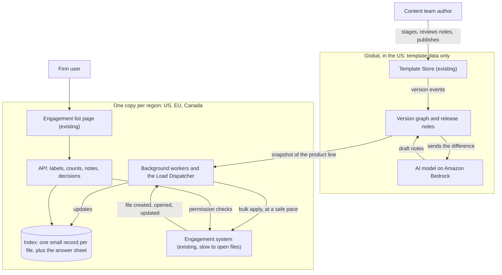
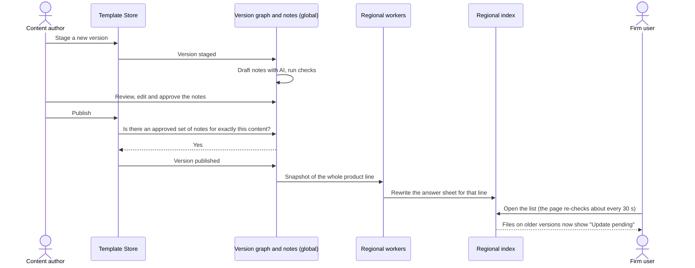
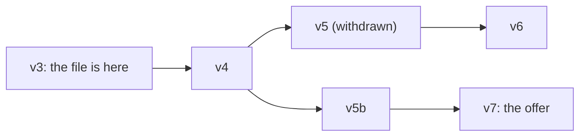
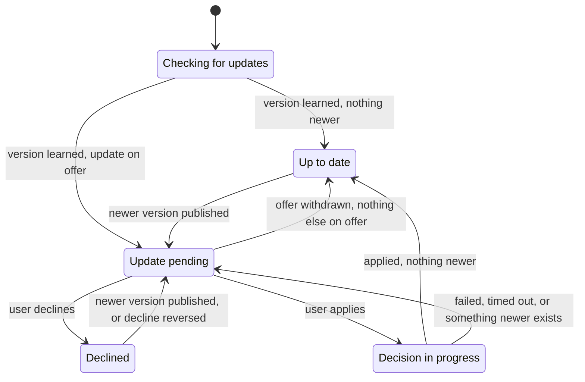
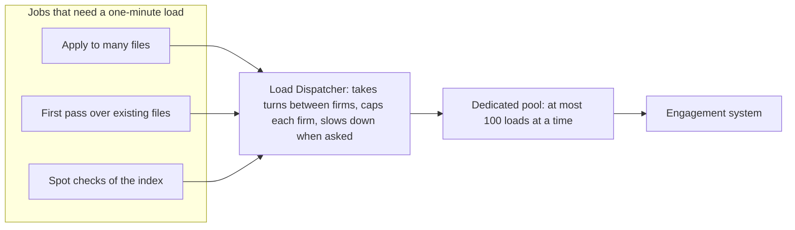

# Template Update Visibility

Design and first implementation of a system that tells accounting firms which of their
engagement files have a pending template update, and what that update changes.

This page is the short version. The [architecture document](docs/03-architecture.md) has
the full design, the arithmetic and the reasons.

## The system in plain words

Accounting firms do a year of work for each client in an **engagement file**. Each file is
built from a **product template**, and the content teams publish a new version of each
template about once a week. For every one of its files, a firm then has to choose: **apply**
the update or **decline** it.

The system answers two questions for about 4,000 firms and 800,000 engagement files:

1. **Which of my files have an update waiting?** A label on each row of the engagement
   list, plus counts and a filter.
2. **What would the update change?** Release notes in plain language, one entry per
   version that the file has not taken yet.

Three things make this harder than it sounds:

- **Opening a file is slow.** Reading a file's template version from the engagement system
  takes about a minute, so the system cannot open files to find out where they stand.
- **Versions are not a straight line.** Markets branch, versions get withdrawn, and a firm
  that declined v5 may later be offered v7, which contains v5's changes.
- **Some data must stay in its region.** Firms in the EU and Canada need their data kept
  there.

The design answers them like this:

| Idea | In plain words |
|---|---|
| A lightweight index | The system keeps a small record per file: which version it is on and which updates were declined. The record is updated whenever the engagement system reports a change, so the slow file never has to be opened just to look. |
| An answer sheet per version | "Which update should a file on version X be offered?" has the same answer for every file on X. The system keeps that answer per version, a few thousand rows, and looks it up when someone opens their list. |
| Publishing touches no files | A publish only rewrites the answer sheet for one product line: a few hundred small rows, not 20,000 file records. That is why a new version shows up within seconds (target: 10 seconds). |
| Notes are checked before release | An AI model drafts the release notes from the exact difference between two versions. Every statement must point at the change it describes, a second model checks the draft, and a content author must approve it. A version cannot be published without approved notes, and the evidence is kept for 10 years. |
| One copy per region | Template content is the same for everyone and is held once, in the US. Anything about a firm's files stays in that firm's region: US, EU or Canada. |
| A queue for the slow work | Some jobs do need the one-minute load, such as applying an update to hundreds of files at once. They all go through one queue, the Load Dispatcher, which shares capacity fairly between firms and slows down when the engagement system is under strain. |
| A safety net for lost messages | Systems talk through messages that can arrive twice, late or not at all. Each message carries a sequence number so old news never overwrites new, and regular checks (every minute and every hour) catch anything that was missed. |

## Architecture at a glance

### The big picture



Only template data crosses regions. The AI model sees the difference between two template
versions and nothing about any firm or file.

### What happens when a template is published



Withdrawing a version follows the same path: a new snapshot, and the answer sheet is
rewritten. Declines of the withdrawn version stop counting without anyone editing them.

### Which update a file is offered

Versions of one product line form a tree. A file is offered the **most recently published
version that descends from the one it is on**, as long as that version has approved notes
and has not been withdrawn.



The file on v3 is offered v7, and its notes list v4, v5b and v7. If v7 is withdrawn the
offer falls back to v6. A decline is remembered against the exact version declined, so
declining v6 does not hide v7 when it arrives.

### What a user sees on each file

| Label | Meaning |
|---|---|
| Checking for updates | The system has not yet learned which version this file is on. It is never shown as up to date by default. |
| Up to date | Nothing newer is on offer. |
| Update pending | A newer version is on offer and no decision has been made about it. |
| Declined | The offered version was declined and nothing newer has been published. |
| Decision in progress | An apply was requested and the engagement system is working on it. |



### What happens to a decision

- **Decline.** Recorded at once in the regional index; the file is not opened. The next
  time anyone opens that file, the engagement system picks up the decline and stores it in
  the file. Until then this system holds the only record, so each decline is also written
  to a separate log in the same region.
- **Apply to one file.** Goes straight to the engagement system, as it does today. The
  label shows "Decision in progress" until the result arrives, 30 minutes at most.
- **Apply to many files.** Becomes a job in the Load Dispatcher. Each file is checked again
  just before its turn, so a file whose offer changed in the meantime is skipped, not
  updated to the wrong version.

### Work that needs the slow load



Existing files have to be read once before they can get a label. That first pass runs in
the background through the same queue, firm by firm. A firm sees the feature only once at
least 95% of its files are indexed, and the rest show "Checking for updates" until their
turn comes or someone opens them.

The [fan-out worker](fanout-worker/README.md) in this repository is the Java core of the
Load Dispatcher.

### Numbers worth remembering

| | |
|---|---|
| Scale | About 4,000 firms, 800,000 active files, 40 products; the largest firm has about 40,000 files |
| Freshness | A publish reaches the labels within 10 seconds on the server; an open page re-checks about every 30 seconds |
| Cost of a publish | A few hundred small rows per region, whatever the number of files |
| Slow work | At most 100 loads at a time (US 70, EU 20, Canada 10), 50 per firm by default |
| Running cost | Up to about $3,789 a month, plus a one-off $1,569 for the first pass; AI is $173 of the monthly figure |

### One requirement the design pushes back on

The brief treats the one-minute load as fixed. The stored file already records its template
version, and the minute is spent on financial fields this feature does not need. If the
engagement system could expose a small header with that version, the first pass would
shrink from about a week of the whole pool to a few hours, and every file could be
re-checked each month. The design works either way; see
[§21](docs/03-architecture.md#21-challenged-requirement).

## Where to start

| If you want to… | Read |
|---|---|
| Understand the task as it was given | [Problem statement](docs/01-brief/problem.md), then [Current systems](docs/01-brief/current-systems.md) |
| See what the system must do | [Requirements](docs/02-requirements.md) |
| See how it is designed, and why | [Architecture](docs/03-architecture.md), starting with [§1 Overview and key decisions](docs/03-architecture.md#1-overview-and-key-decisions) |
| Review the Java code | [fanout-worker/README.md](fanout-worker/README.md) |

## Documents, in reading order

| # | Document | What it is | Length |
|---|---|---|---|
| 1 | [Problem statement](docs/01-brief/problem.md) | The original brief: scale, freshness, cost and version-graph expectations | 1 page |
| 1 | [Current systems](docs/01-brief/current-systems.md) | What already exists, including the ~1 minute engagement load | 1 page |
| 1 | [MVP brief](docs/01-brief/mvp-brief.md) | The narrow Java component to implement | ½ page |
| 2 | [Requirements](docs/02-requirements.md) | Functional and non-functional requirements, decision log, tradeoffs | ~300 lines |
| 3 | [Architecture](docs/03-architecture.md) | Full system design with diagrams, cost model and ADRs | ~1,800 lines |

The two long documents open with a linked table of contents.

## Architecture shortcuts

| Topic | Section |
|---|---|
| The eight key decisions | [§1](docs/03-architecture.md#1-overview-and-key-decisions) |
| How pending state is computed | [§6](docs/03-architecture.md#6-version-graph-offer-computation-and-engagement-state) |
| Data model | [§7](docs/03-architecture.md#7-data-model) |
| Sequence diagrams for publish, withdraw, apply, decline | [§9](docs/03-architecture.md#9-key-flows) |
| The Load Dispatcher and how the Java MVP maps onto it | [§11](docs/03-architecture.md#11-load-dispatcher-bulk-decisions-and-the-mvp-worker) |
| Cost model | [§16](docs/03-architecture.md#16-cost-model) |
| Failure modes | [§18](docs/03-architecture.md#18-failure-modes) |
| Tradeoffs and ADRs | [§20](docs/03-architecture.md#20-tradeoffs-and-adrs) |

## Code

| Module | What it is | Run |
|---|---|---|
| [fanout-worker](fanout-worker/README.md) | Java 21 library: the template-publish fan-out worker (MVP) | `cd fanout-worker && mvn test` |

## Layout

```
README.md               this index
docs/
  01-brief/             the task as given (problem, current systems, MVP brief)
  02-requirements.md    what the system must do
  03-architecture.md    how it is designed
fanout-worker/          Java implementation of the MVP worker
```
