# Template Update Visibility: Architecture and System Design

| | |
|---|---|
| **Status** | Draft v0.2 for review. Architect draft (ECC architect) reconciled with clarifications CL-1 to CL-4 (§3) and with verified prices (§16.1). |
| **Date** | 2026-11-12 |
| **Inputs** | [Requirements](02-requirements.md) v1.0 (authoritative), [problem](01-brief/problem.md), [current systems](01-brief/current-systems.md), [MVP brief](01-brief/mvp-brief.md) |
| **Prices** | AWS unit prices come from the official AWS Price List files for us-east-1, eu-west-1 and ca-central-1, read on 2026-11-12. Prices that were not re-checked are marked in §16.1. All cost arithmetic is quantity × unit price. |

---

## Contents

- [1. Overview and key decisions](#1-overview-and-key-decisions)
- [2. Reviewer traceability](#2-reviewer-traceability)
- [3. Assumptions (beyond REQUIREMENTS §6)](#3-assumptions-beyond-requirements-6)
- [4. System context (C4 level 1)](#4-system-context-c4-level-1)
- [5. Logical architecture](#5-logical-architecture)
  - [5.1 Container view (C4 level 2)](#51-container-view-c4-level-2)
  - [5.2 Components and responsibilities](#52-components-and-responsibilities)
  - [5.3 What is global and what is regional](#53-what-is-global-and-what-is-regional)
  - [5.4 Data ownership](#54-data-ownership)
- [6. Version graph, offer computation and engagement state](#6-version-graph-offer-computation-and-engagement-state)
  - [6.1 Decision on T-1: derive on read](#61-decision-on-t-1-derive-on-read)
  - [6.2 Graph model and the offer algorithm](#62-graph-model-and-the-offer-algorithm)
  - [6.3 Notes stack (FR-2.2, FR-2.3, FR-3.8)](#63-notes-stack-fr-22-fr-23-fr-38)
  - [6.4 Invariants](#64-invariants)
  - [6.5 Engagement state machine (FR-1.5)](#65-engagement-state-machine-fr-15)
  - [6.6 How correctness is verified](#66-how-correctness-is-verified)
- [7. Data model](#7-data-model)
  - [7.1 Entity-relationship diagram](#71-entity-relationship-diagram)
  - [7.2 Indexes and isolation](#72-indexes-and-isolation)
  - [7.3 Storage arithmetic per zone](#73-storage-arithmetic-per-zone)
- [8. Physical architecture and residency](#8-physical-architecture-and-residency)
  - [8.1 Deployment view across the three zones](#81-deployment-view-across-the-three-zones)
  - [8.2 Store selection (D-24)](#82-store-selection-d-24)
  - [8.3 Residency rules (NFR-9, A-3, C-4)](#83-residency-rules-nfr-9-a-3-c-4)
  - [8.4 Routing](#84-routing)
- [9. Key flows](#9-key-flows)
  - [9.1 Publish with notes review gate](#91-publish-with-notes-review-gate)
  - [9.2 Withdraw](#92-withdraw)
  - [9.3 Backfill and capture-on-load](#93-backfill-and-capture-on-load)
  - [9.4 Decline without load, then write-back (FR-4.9, FR-4.4)](#94-decline-without-load-then-write-back-fr-49-fr-44)
  - [9.5 Apply (FR-4.1, FR-4.2, FR-4.7)](#95-apply-fr-41-fr-42-fr-47)
  - [9.6 Bulk apply (FR-4.6, FR-4.8, NFR-19)](#96-bulk-apply-fr-46-fr-48-nfr-19)
- [10. Event delivery and reconciliation](#10-event-delivery-and-reconciliation)
- [11. Load Dispatcher: bulk decisions and the MVP worker](#11-load-dispatcher-bulk-decisions-and-the-mvp-worker)
  - [11.1 Work classes](#111-work-classes)
  - [11.2 Scheduling](#112-scheduling)
  - [11.3 Bulk-apply guarantees (FR-4.8)](#113-bulk-apply-guarantees-fr-48)
  - [11.4 Interactive protection (NFR-19)](#114-interactive-protection-nfr-19)
  - [11.5 Mapping the Java MVP "template-publish fan-out worker"](#115-mapping-the-java-mvp-template-publish-fan-out-worker)
- [12. Migration, backfill and rollout](#12-migration-backfill-and-rollout)
  - [12.1 Phases](#121-phases)
  - [12.2 What users see during the pass](#122-what-users-see-during-the-pass)
  - [12.3 A publish during the backfill](#123-a-publish-during-the-backfill)
  - [12.4 Cut-over and rollback](#124-cut-over-and-rollback)
- [13. Release notes: generation, evaluation and audit defence](#13-release-notes-generation-evaluation-and-audit-defence)
  - [13.1 Pipeline (Step Functions `tuv-notes`; FR-2.5, FR-2.6, NFR-3)](#131-pipeline-step-functions-tuv-notes-fr-25-fr-26-nfr-3)
  - [13.2 Automated checks before human review](#132-automated-checks-before-human-review)
  - [13.3 Large diffs](#133-large-diffs)
  - [13.4 Model or prompt changes, and provider failure](#134-model-or-prompt-changes-and-provider-failure)
  - [13.5 Evaluation](#135-evaluation)
  - [13.6 Defending a March summary in November](#136-defending-a-march-summary-in-november)
  - [13.7 Model selection and tiering](#137-model-selection-and-tiering)
  - [13.8 Price comparison across providers](#138-price-comparison-across-providers)
- [14. Scale arithmetic](#14-scale-arithmetic)
  - [14.1 Publish blast radius (NFR-7)](#141-publish-blast-radius-nfr-7)
  - [14.2 NFR-1 latency budget (p99, server-side, from publish commit)](#142-nfr-1-latency-budget-p99-server-side-from-publish-commit)
  - [14.3 Read traffic (D-17 polling dominates)](#143-read-traffic-d-17-polling-dominates)
  - [14.4 Backfill (NFR-13, FR-5.3)](#144-backfill-nfr-13-fr-53)
  - [14.5 Bulk apply, largest firm (NFR-19, T-8)](#145-bulk-apply-largest-firm-nfr-19-t-8)
  - [14.6 Inference (NFR-8)](#146-inference-nfr-8)
  - [14.7 Steady-state decision volume and load-pool capacity](#147-steady-state-decision-volume-and-load-pool-capacity)
- [15. Availability, durability and consistency](#15-availability-durability-and-consistency)
  - [15.1 Read-path availability (NFR-11: 99.9% = 43.8 min per 43,800-min month)](#151-read-path-availability-nfr-11-999--438-min-per-43800-min-month)
  - [15.2 Durability and recovery](#152-durability-and-recovery)
  - [15.3 Consistency model](#153-consistency-model)
- [16. Cost model](#16-cost-model)
  - [16.1 Unit prices](#161-unit-prices)
  - [16.2 Provisioned option (chosen): per zone, on-demand, at each region's own prices](#162-provisioned-option-chosen-per-zone-on-demand-at-each-regions-own-prices)
  - [16.3 Global plane (identical in both options)](#163-global-plane-identical-in-both-options)
  - [16.4 Platform totals](#164-platform-totals)
  - [16.5 Serverless option (for comparison; forced into fan-out, §8.2)](#165-serverless-option-for-comparison-forced-into-fan-out-82)
  - [16.6 Load pool, options and one-off items](#166-load-pool-options-and-one-off-items)
  - [16.7 The monthly figure, against $X](#167-the-monthly-figure-against-x)
- [17. Observability and SLOs (NFR-15)](#17-observability-and-slos-nfr-15)
  - [17.1 SLOs](#171-slos)
  - [17.2 Alerts](#172-alerts)
  - [17.3 Dashboards](#173-dashboards)
- [18. Failure modes](#18-failure-modes)
- [19. Security and tenant isolation](#19-security-and-tenant-isolation)
- [20. Tradeoffs and ADRs](#20-tradeoffs-and-adrs)
  - [20.1 Tradeoffs](#201-tradeoffs)
  - [20.2 ADRs (condensed)](#202-adrs-condensed)
  - [20.3 Evolution path](#203-evolution-path)
- [21. Challenged requirement](#21-challenged-requirement)
- [22. Riskiest part, deliberately left out, open risks](#22-riskiest-part-deliberately-left-out-open-risks)
  - [22.1 Riskiest part: index correctness without a cheap source read](#221-riskiest-part-index-correctness-without-a-cheap-source-read)
  - [22.2 Deliberately left out](#222-deliberately-left-out)
  - [22.3 Open risks](#223-open-risks)

---

## 1. Overview and key decisions

The system keeps a **regional engagement index** that holds each engagement's current version, declines and assignments, one index per residency zone. It also keeps a **global version graph with immutable, reviewed release notes**. Pending state is **derived on read** by joining the index to a small per-branch **offer map**. A publish or withdraw recomputes that map in O(versions on the branch), not O(engagements). Any work that needs an engagement load (backfill, bulk apply, drift audit) goes through one admission-controlled **Load Dispatcher**. The Java MVP worker maps onto the Dispatcher.

| # | Decision | Section | Requirements served |
|---|---|---|---|
| K-1 | Derive pending state on read over a materialised per-branch offer map. No per-engagement writes on publish or withdraw. | §6, ADR-001 | T-1, FR-1.3, FR-1.8, FR-3.x, NFR-1, NFR-2, NFR-4, NFR-7 |
| K-2 | One Aurora PostgreSQL cluster per residency zone, with ECS Fargate compute. The serverless (DynamoDB) option is rejected on query shape, not price. | §8.2, ADR-002 | D-24, NFR-4, NFR-8, NFR-9 |
| K-3 | The global graph reaches each zone as event-carried **branch snapshots**: full branch state, applied when `graph_seq` is newer, plus a 60 s heads poll. | §10, ADR-003 | NFR-1, NFR-2, NFR-9, NFR-12 |
| K-4 | Within a branch, versions form a **tree** (single parent, forks allowed, no merges). The offer is the most recently published eligible descendant. | §6.2, ADR-005 | FR-3.1, FR-3.2, FR-3.6 |
| K-5 | A single Load Dispatcher, using deficit-round-robin fair queueing, a per-firm cap and a monthly load-minute ceiling, runs all work that needs a load. This is where the MVP "fan-out worker" lives. | §11, ADR-004 | FR-4.6, FR-4.8, FR-5.3, NFR-13, NFR-19 |
| K-6 | Notes are grounded: every item cites change-unit IDs taken from the canonical diff. Deterministic gates and a judge model run before mandatory author approval. The evidence bundle is stored in S3 Object Lock with a KMS-signed manifest. | §13, ADR-006 | FR-2.5–2.7, NFR-16, NFR-17 |
| K-7 | Declines are recorded only in the index and written back by a synchronous, fail-open pull from the engagement system's load path. A per-zone decision log in S3, replicated within the zone, protects the one case where this system is the only record. | §9.4, §15, ADR-008 | FR-4.9, FR-5.5, NFR-18 |
| K-8 | Challenged brief requirement: "reading template information requires a ~1-minute load" (C-1), as it applies to **reading template state**. | §21 | C-1, NFR-13 |

---

## 2. Reviewer traceability

| Graded item / topic | Where answered |
|---|---|
| 1. Architecture and data ownership | §4, §5 (5.1–5.4 ownership), §7, §8 |
| 2. Correctness and production evolution | §6 (algorithm, invariants, verification), §9, §10, §15.3, §20.3 |
| 3. Scale, cost, operational characteristics (arithmetic) | §7.3, §14 (14.7 for steady-state load), §16 (16.7 for the monthly figure), §17 |
| 4. Summary generation, evaluation, regulatory defence | §13 |
| 5. Tradeoffs, assumptions, challenged requirement | §3, §20, §21 |
| Migration and backfill | §12, §14.4 |
| Unreliable event delivery | §10 |
| Observability and SLOs | §17 |
| Data residency | §8.3, §8.4 |
| Failure recovery | §15, §18 |
| MVP fan-out worker mapping | §11.5 |
| Riskiest part, left out, open risks | §22 |

---

## 3. Assumptions (beyond REQUIREMENTS §6)

| ID | Assumption | Used in |
|---|---|---|
| AS-01 | Within a branch, versions form a tree. Every version has exactly one parent, which is a PUBLISHED version on the same branch or, for a branch root, a version on another branch. A version may have several children. No merges. The Graph Service enforces this when a version is staged and warns the author when the parent already has a child. Confirmed by CL-4. | §6 |
| AS-02 | The template store supports staged (unpublished) versions and a pre-publish hook that can reject a publish unless approved notes exist for the exact diff hash. | §9.1, §13 |
| AS-03 | The template store stamps a per-product monotonic `ts_seq` on events and can list versions since a given seq. | §10 |
| AS-04 | The engagement system (ES) stamps a per-engagement monotonic `engagement_seq` on every engagement event, and a per-firm `assignment_seq` on assignment events. | §10 |
| AS-05 | ES exposes these calls **without a load**: a per-firm catalog (id, name, client, lifecycle, `last_opened_at`, template id if known), per-firm assignments with a digest, and a batch `canDecide(user, engagement[])`. | §9, §10, §12 |
| AS-06 | ES apply and acquire commands are asynchronous, accept an idempotency key, expose status by key, and **reject** when the engagement's actual current version differs from `from_version`. | §9.5, §11 |
| AS-07 | The ES load path can call our write-back endpoint with a 300 ms timeout, fail open, and report the IDs of applied write-back ops in `EngagementLoaded`. | §9.4 |
| AS-08 | Background loads run on a **dedicated low-priority pod pool** paid for by this feature: at most 100 pods (US 70, EU 20, CA 10), scaling to zero when idle, driven by a demand signal. One load occupies one pod for ~1 min. The engagement team's limit is its shared database and control plane, not pods. Confirmed by CL-2. | §11, §14, §16.6 |
| AS-09 | Loads that interactive users trigger themselves stay on the engagement system's existing interactive pods and are not billed to this feature. | §14.7, §16.6 |
| AS-10 | Peak concurrent users with an open list page: 20,000 (CL-1). Business-hours average: 8,000 (40% of peak). Off-hours average: 600. 220 business hours and 510 off-hours per month. Polling pauses when the tab is hidden. | §14.3 |
| AS-11 | Non-poll API calls (list pages, notes, decisions) are 10% of polls. | §14.3 |
| AS-12 | Engagements and traffic split by zone: US 70%, EU 20%, CA 10%. | §7.3, §16 |
| AS-13 | On average 4 users are assigned to each engagement. | §7.3 |
| AS-14 | Per engagement per year: ~30 decision-history rows and ~10 version-history rows. Sizing horizon is 7 years. | §7.3 |
| AS-15 | Diff size per version: median 15k tokens, mean 40k, p99 400k. | §13, §14.6 |
| AS-16 | 30% of active engagements are opened organically during the backfill window. | §14.4 |
| AS-17 | Apply outcome timeout: 30 min. | §9.5 |
| AS-18 | Zones: US = us-east-1 (also hosts the global plane, alongside the template store). EU = eu-west-1. CA = ca-central-1. In-zone backup copies go to us-west-2, eu-central-1 and ca-west-1. | §8 |
| AS-19 | Release-notes evidence is kept 10 years under S3 Object Lock in compliance mode. | §13.6 |
| AS-20 | The platform IdP issues JWTs carrying `user_id`, `firm_id`, `is_firm_admin` and `zone`. The front end calls the endpoint for that zone. | §8, §19 |
| AS-21 | ES pod-hour cost proxy is a 2 vCPU / 8 GB Fargate equivalent. | §14, §16 |
| AS-22 | The ES front end owns the engagement list UI. It embeds our indicator, count and filter APIs and renders without them if they fail (NFR-11). | §5 |
| AS-23 | Firms with no residency requirement are served from the US zone. | §8 |
| AS-24 | The ES event stream includes decisions made outside this feature's UI. | §10 |
| AS-25 | Withdrawal is irreversible. Re-publishing the same content is a new version. | §6 |
| AS-26 | 25% of applies are submitted as bulk actions and run on the dedicated pool. The rest are single applies on the interactive path (AS-09). Planning figure only; the monthly ceiling (§11.2) is what bounds spend. | §14.7, §16.6 |

Clarifications received from the requirements owner on 2026-11-12:

| ID | Question | Answer | Effect |
|---|---|---|---|
| CL-1 | Peak concurrent users | ~20,000 | AS-10, §14.3, §16 |
| CL-2 | Capacity for background loads | Dedicated pool, ~100 parallel | AS-08, §11, §14.4, §16.6 |
| CL-3 | Inference route | Claude on Amazon Bedrock | §13, §14.6, §16.3 |
| CL-4 | Shape of the graph inside a branch | Tree: design for the general case | AS-01, §6.2, ADR-005 |

---

## 4. System context (C4 level 1)

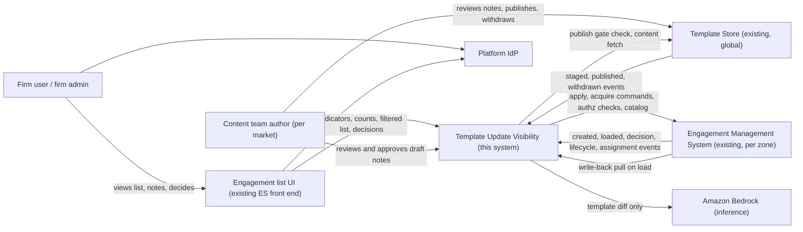

| External system | Role | Owned by |
|---|---|---|
| Template Store | Stores versioned template archives; authoritative for publish and withdraw (C-3, FR-3.1) | Template team |
| Engagement Management System | Loads engagements; creates them; processes apply and decline; enforces permissions (C-7, FR-4.5) | ES team |
| Engagement list UI | The page users see. Calls our APIs, degrades without them (NFR-11) | ES front-end team |
| Amazon Bedrock | Generates and judges draft notes. Receives template content only (NFR-17) | AWS |

---

## 5. Logical architecture

### 5.1 Container view (C4 level 2)

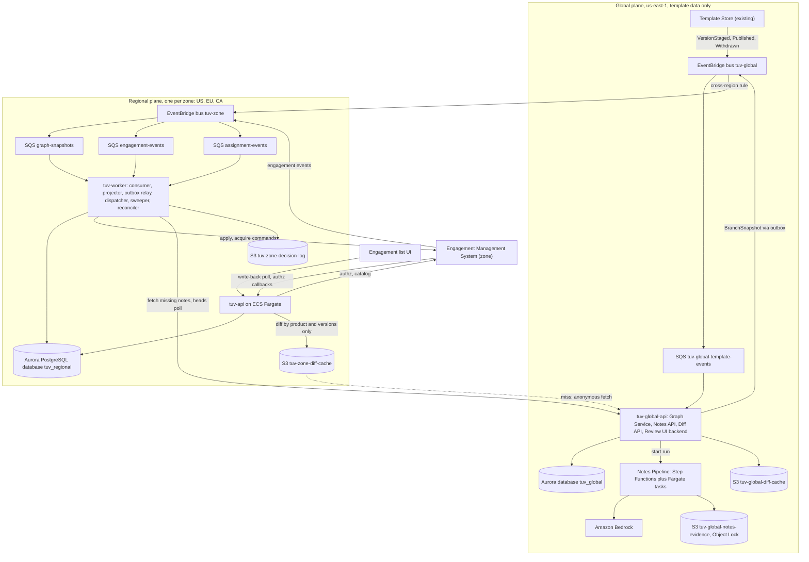

### 5.2 Components and responsibilities

| Component | Plane | Responsibility | Requirements |
|---|---|---|---|
| **Graph Service** (`tuv-global-api`) | Global | Validates staged versions against the tree invariants (AS-01). Appends version events (published, withdrawn). Assigns `graph_seq` per branch. Emits `BranchSnapshot`. Serves `/graph/heads`, snapshots, descendants for withdraw (FR-3.7). | FR-3.1, FR-3.7, FR-5.1 |
| **Notes Pipeline** (Step Functions `tuv-notes`) | Global | diff, change units, generation, deterministic checks, judge, review package. Freezes approved notes and signs the evidence manifest. | FR-2.5–2.7, NFR-16, NFR-17 |
| **Notes API + Review UI backend** | Global | Draft review, edits, approval. Publish-gate check for the template store. | FR-2.7, D-13 |
| **Diff API** | Global | Computes and caches the JSON diff per version pair. Sees only product and version IDs. | FR-2.8, NFR-20 |
| **tuv-api** | Regional | Indicators, filtered list, counts, notes stack, decisions, bulk jobs, write-back endpoint, diff proxy. | FR-1.x, FR-2.1–2.3, FR-4.x |
| **Engagement Event Consumer** | Regional | Applies ES events to the index, conditional on seq. Writes inbox entries for idempotency. | FR-5.2, FR-5.4 |
| **Graph Projector** | Regional | Applies branch snapshots, fetches missing notes, recomputes `version_offer` in one transaction. | NFR-1, NFR-2, FR-3.x |
| **Outbox Relay** | Both | Publishes outbox rows to EventBridge or ES at least once. | §10 |
| **Load Dispatcher** | Regional | Fair, capped, idempotent dispatch of load-requiring work: bulk apply, acquisition, drift audit, write-back flush. | FR-4.6, FR-4.8, FR-5.3, NFR-13, NFR-19 |
| **Attempt Sweeper** | Regional | Apply timeouts (AS-17). Checks status by attempt ID. Appends void audit rows. | FR-4.2, FR-3.5 |
| **Reconciler** | Regional | Graph heads poll every 60 s. Hourly catalog and assignment-digest diff. Feeds the drift-audit sample. | FR-5.5, NFR-12 |

### 5.3 What is global and what is regional

| Data / processing | Location | Reason |
|---|---|---|
| Template content, diffs, version graph, withdrawn flags, release notes, notes evidence | Global (us-east-1) | Template content is not firm-specific (C-5, NFR-9). |
| Read-only copy of graph, notes and offer map | Each zone (`tuv_regional.version`, `release_notes`, `version_offer`) | Keeps the read path inside the zone (NFR-11) and makes the join possible. |
| Engagement index, assignments, decision history, bulk jobs, dispatcher state, write-back ops, decision log | Regional only | Residency-bound metadata (A-3, NFR-9). |
| Inference | Global (Bedrock, us-east-1) | Input is a template diff only (NFR-17). |
| Diff details for a user | Regional proxy, then a global fetch carrying only `(product, from, to)` with a service identity | Firm or user identity plus a version pair would reveal an engagement's version, which is metadata (A-3), so neither is sent. |

### 5.4 Data ownership

| Entity | System of record | Copies held | Conflict winner |
|---|---|---|---|
| Template content | Template Store | Global diff cache | Template Store |
| Version ancestry, branch, publish time | Template Store (events) | `tuv_global.g_version`, regional `version` | Template Store. Zones defer to the Graph Service `graph_seq`. |
| Withdrawn flag | Template Store | Same as above | Template Store |
| Release notes and evidence | **This system (global)**. Sole record. | Regional `release_notes` (read-only) | Global copy; immutable (D-15) |
| Engagement existence, name, lifecycle | ES | `engagement_index` | ES |
| Engagement current version | ES | `engagement_index.current_version_seq` | **ES** (FR-5.5) |
| Declines already written into the engagement | ES | `declined_version_seqs`, `decision` | ES |
| **Declines not yet written back** | **This system (regional index). Sole record.** (FR-4.9, NFR-18) | Zone decision log in S3 (§15) | **Index** (FR-5.5) |
| Decision history | This system (regional), append-only | Decision log in S3 | This system |
| Apply outcome | ES | `decision` rows | ES |
| Assignments and permissions | ES | `user_assignment` mirror | ES. Decisions always re-check live (FR-4.5). |
| Offer and pending state | Derived; not stored per engagement | n/a | Recomputed |
| Bulk jobs, dispatcher leases, rollout flags | This system (regional) | n/a | This system |

---

## 6. Version graph, offer computation and engagement state

### 6.1 Decision on T-1: derive on read

| Criterion | Derive on read over offer map (**chosen**) | Fan-out on publish |
|---|---|---|
| Rows written per publish | ≤ ~200 per zone (§14.1) | ~20,000 engagement rows, plus per-user counters |
| Withdraw | Same O(V_b) recompute. Declines are voided implicitly. | Re-target ~20,000 rows and void declines row by row |
| NFR-1 budget | Independent of engagement count (§14.2) | Depends on the size of the write; hot counters on large firms |
| Filter by pending (FR-1.3) | Scan the firm's rows (≤ 40,000) with a hash join: ~20–40 ms | Index range on a stored state column |
| Per-user counts (FR-1.8) | `GROUP BY` over the user's assignments, cached by ETag | Counters per user, maintained per state change × 4 assignments (AS-13) |
| Drift risk | None for offers. The offer logic exists in one place. | A stored per-row offer can drift from the graph |
| Voided declines (FR-3.5), withdrawn flag (FR-3.6), re-offer (FR-3.4) | Fall out of the derivation | Explicit per-row maintenance |

**Why this satisfies the read requirements.** An engagement's offer depends only on its `current_version_seq`, because the branch is implied by the version (A-1). The number of distinct current versions is small: 40 products × a few branches × ~52 versions per year gives a few thousand. The offer can therefore be precomputed **per version**, not per engagement. The result is a small table that Postgres hash-joins in memory. The per-engagement cost at read time is one hash probe plus one array membership test. That is O(N) in the user's engagements, bounded at 40,000 by NFR-4.

### 6.2 Graph model and the offer algorithm

Global model:
- `g_version(version_seq, product_id, branch_id, publish_seq, parent_version_seq, state STAGED|PUBLISHED)`
- An append-only `g_version_event(PUBLISHED|WITHDRAWN, at)`

`publish_seq` is assigned by the Graph Service when a version is published and increases monotonically per branch. AS-01 makes each branch a tree: one parent per version, any number of children. A child is always published after its parent, so `child.publish_seq > parent.publish_seq`. A branch root's parent is on another branch, and D-2 means an engagement on the parent branch is never offered the root.

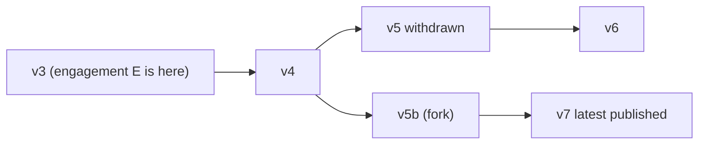

In this example `offer(v3) = v7`, the most recently published eligible descendant. The notes stack is v4, v5b, v7. If v7 is withdrawn, the offer becomes v6 and the stack becomes v4, v5 (shown as withdrawn, FR-3.8), v6.

**Definition (FR-3.2).** `eligible(w)` means `w` is PUBLISHED, has approved notes, and is not withdrawn. For a version `v` on branch `b`:
`offer(v)` = the eligible version `w` on `b` with the greatest `publish_seq` among the strict descendants of `v`. If `v` has no eligible descendant, `offer(v)` is null.

**Recompute per branch.** Runs on every snapshot, in the projector transaction. It needs parent pointers only; no closure table.

```
recompute(b):
  -- visiting in publish_seq DESC order reaches every child before its parent
  for v in versions(b) ordered by publish_seq DESC:
      offer[v]    := latest( best_sub[c] for c in children(v) )      -- NULL if no child has one
      best_sub[v] := latest( offer[v], v if eligible(v) else NULL )  -- best in the subtree rooted at v
      current_withdrawn[v] := (v.withdrawn_at IS NOT NULL)
  upsert version_offer for all v in b                                -- one statement

latest(...) := the non-NULL argument with the greatest publish_seq
```

Complexity is O(V_b) time and writes, because each version is visited once and each parent-child edge is read once. V_b is on the order of 52 per branch-year (40 publishes a week across 40 products). One publish therefore rewrites at most a few hundred small rows per zone. A linear branch is the special case where every version has one child.

**Consequences of allowing forks inside a branch.**

| Situation | Behaviour | Requirement |
|---|---|---|
| Two lines fork from v4; the engagement is on v3 | It is offered the most recently published eligible version across both lines | FR-3.2 |
| The engagement applies v7 on the fork line | Versions on the other line (v5, v6) are no longer descendants of its current version and are never offered to it | D-2, FR-3.2 |
| A newer version is published on the other line while the engagement is still on v3 | The offer moves to it, and a decline of the previous offer no longer matches, so the engagement is pending again | FR-3.4 |
| The engagement's current version is withdrawn | It is flagged, and it is still offered eligible descendants of that version | FR-3.6 |

A fork therefore splits a branch's engagements permanently between the two lines. The Graph Service warns the author at staging time when the chosen parent already has a child.

**Derived state per engagement (FR-1.5).** SQL function used by every read:

```sql
CREATE FUNCTION tuv_state(e engagement_index, vo version_offer) RETURNS text
LANGUAGE sql STABLE AS $$
  SELECT CASE
    WHEN e.index_state <> 'INDEXED'                          THEN 'CHECKING'
    WHEN vo.version_seq IS NULL                              THEN 'CHECKING'    -- version not yet replicated
    WHEN e.apply_attempt_id IS NOT NULL                      THEN 'IN_PROGRESS'
    WHEN vo.offer_version_seq IS NULL                        THEN 'UP_TO_DATE'
    WHEN vo.offer_version_seq = ANY (e.declined_version_seqs) THEN 'DECLINED'
    ELSE 'PENDING'
  END $$;
-- last_attempt_failed := state = 'PENDING' AND e.last_failed_target_seq = vo.offer_version_seq
-- withdrawn_current   := vo.current_withdrawn                 (FR-3.6; clears automatically when current moves)
```

`declined_version_seqs` holds **all** non-reversed declines, not only the latest. Example: decline v6, then v7 arrives, decline v7, then v7 is withdrawn. The offer returns to v6, and v6 is still declined, so the state must be DECLINED. A "last decline" column would get this wrong.

**List and count queries (FR-1.3, FR-1.8).**

```sql
-- page of a user's engagements filtered by state/product, keyset-paginated
SELECT e.engagement_id, e.display_name, e.client_name, e.product_id, s.state, vo.offer_version_seq,
       vo.current_withdrawn
FROM user_assignment ua
JOIN engagement_index e ON e.engagement_id = ua.engagement_id
LEFT JOIN version_offer vo ON vo.version_seq = e.current_version_seq
CROSS JOIN LATERAL (SELECT tuv_state(e, vo) AS state) s
WHERE ua.user_id = $user AND ua.firm_id = $firm AND e.lifecycle = 'ACTIVE'
  AND ($product IS NULL OR e.product_id = $product)
  AND ($state IS NULL OR s.state = $state)
  AND (e.display_name, e.engagement_id) > ($after_name, $after_id)
ORDER BY e.display_name, e.engagement_id
LIMIT 50;
-- admin firm-wide variant: drop user_assignment, filter e.firm_id = $firm (FR-1.8)
-- counts: same FROM/WHERE, SELECT product_id, count(*) FILTER (WHERE state='PENDING'), ... GROUP BY product_id
```

### 6.3 Notes stack (FR-2.2, FR-2.3, FR-3.8)

`path(E)` = the versions on the parent chain from `offer(current)` back to `current`, excluding `current`, ordered oldest first. A tree gives exactly one such path. It is read with a recursive query over `parent_version_seq` and includes withdrawn versions. Each entry is labelled with its version and, when applicable:
- `declined` if `version_seq ∈ declined_version_seqs`, or if a voided decline is recorded in `decision`
- `withdrawn, changes included in vN` if `withdrawn_at` is set (FR-3.8)

Complexity is O(path length). FR-3.7 (descendants of a version to be withdrawn) uses the same parent pointers in the other direction.

### 6.4 Invariants

| ID | Invariant | Enforced by |
|---|---|---|
| I-1 | `version_offer` for branch b equals `recompute(b)` over the zone's copy at `branch_state.graph_seq` | Single projector transaction per snapshot |
| I-2 | `offer(v) ≠ v`; an offer is never withdrawn; an offer is never a STAGED version | Algorithm; FK and `CHECK` |
| I-3 | Every `offer_version_seq` has a `release_notes` row in the zone (FR-2.7) | FK `version.notes_id NOT NULL` for eligibility; projector fetches notes before commit |
| I-4 | `branch_state.graph_seq` never decreases in a zone | Conditional update `WHERE graph_seq < :new` |
| I-5 | `engagement_index.current_version_seq` is on `engagement_index.branch_id` | Consumer validation; violation goes to DLQ and alert |
| I-6 | A decline or apply is accepted only if `offered_version_seq = offer(current)` when it commits (FR-4.7) | Decision transaction locks the engagement row `FOR UPDATE` and the `version_offer` row `FOR SHARE`; the projector takes `FOR UPDATE` |
| I-7 | An engagement that is not indexed, unknown, or on an unreplicated version is never UP_TO_DATE (FR-1.5) | CASE order; batch API returns CHECKING for unknown IDs |
| I-8 | At most one apply in flight per engagement | Single `apply_attempt_id` column; partial unique index on in-flight dispatcher items |
| I-9 | `current_version_seq` changes only through an ES event with a greater `engagement_seq` (ES wins, FR-5.5) | Conditional upsert |
| I-10 | `decision` is append-only | No `UPDATE` grant; `DELETE` granted only to the engagement-deletion job (NFR-14, D-28) |

### 6.5 Engagement state machine (FR-1.5)

The state is a pure function of its inputs (§6.2). The diagram specifies the transitions that the function must exhibit as its inputs change.

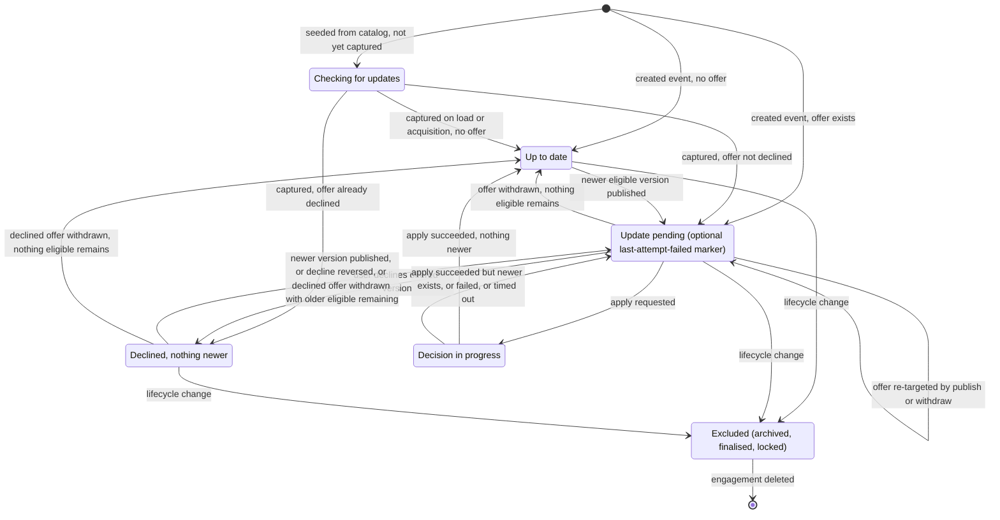

The `withdrawn current version` flag (FR-3.6) is an orthogonal attribute and can be set in any state.

### 6.6 How correctness is verified

| Technique | Target |
|---|---|
| Property-based tests on `recompute` and `tuv_state` against a brute-force oracle. The generator produces random branch trees (including forks) with publishes, withdrawals, declines and reversals. | I-1, I-2, FR-3.2–3.6, D-16 |
| Deterministic simulation of event streams with duplication, reordering, delay and loss, asserting convergence after reconciliation | §10, I-4, I-9 |
| Contract tests with ES for AS-04 to AS-07 | Integration |
| Load test: synthetic firm with 40,000 engagements, 200 concurrent admins polling, publish storms | NFR-4, §14.3 |
| Drift-audit sample in production (§17) | Measures the real index-vs-ES error rate |

---

## 7. Data model

### 7.1 Entity-relationship diagram

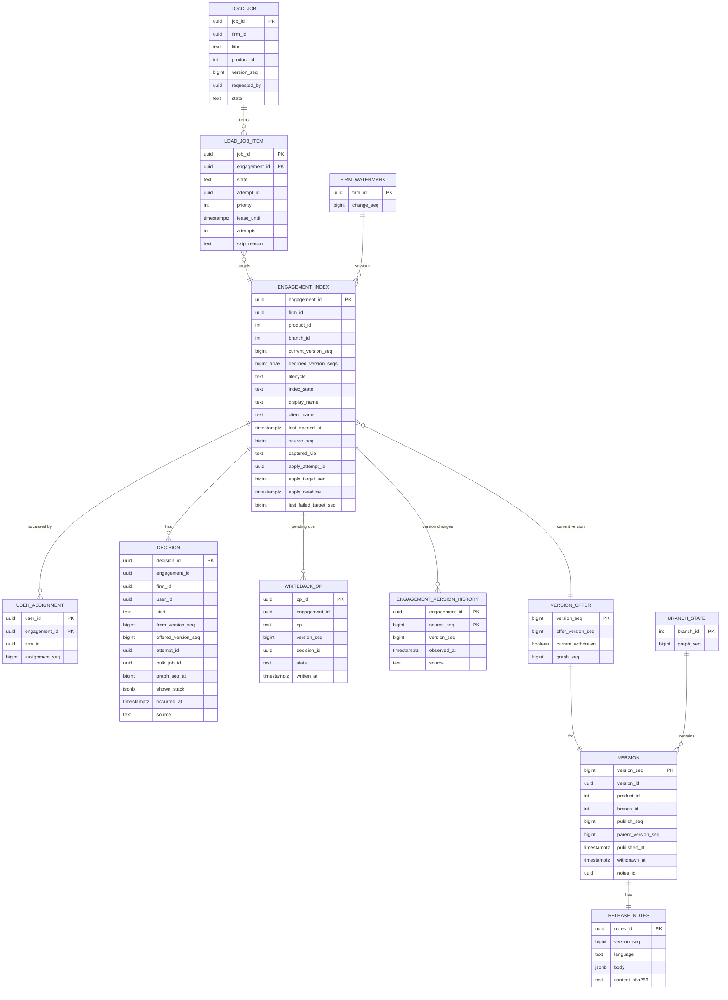

Supporting regional tables, not drawn: `inbox(source, event_id PK)`, `outbox(id, topic, payload, created_at, published_at)`, `firm_rollout(firm_id PK, state, wave, enabled_at)`, `dispatcher_budget(month, kind, load_minutes_used, ceiling)`.

Global tables in the `tuv_global` database:
- `g_version`
- `g_version_event` (append-only)
- `g_branch(branch_id, product_id, market, language, graph_seq)`
- `g_notes(notes_id, version_seq, body, content_sha256, approved_by, approved_at, evidence_manifest_key)`
- `g_notes_draft`
- `g_notes_edit` (append-only)
- `g_generation_run`
- `g_check_result`
- `g_diff_cache(product_id, from_seq, to_seq, s3_key, diff_sha256)`

`decision.kind` ∈ {APPLY_REQUESTED, APPLY_SUCCEEDED, APPLY_FAILED, APPLY_TIMED_OUT, APPLY_LATE_OUTCOME, DECLINED, DECLINE_REVERSED, DECLINE_VOIDED, DECLINE_WRITTEN_BACK, EXTERNAL_DECISION, IMPORTED_DECLINE, SKIPPED_OFFER_CHANGED}.

### 7.2 Indexes and isolation

| Table | Index | Serves |
|---|---|---|
| `engagement_index` | PK; `(firm_id, display_name, engagement_id)`; `(firm_id, product_id)`; partial `(firm_id) WHERE index_state <> 'INDEXED'` | Admin list and sort, product filter, unindexed count |
| `user_assignment` | PK `(user_id, engagement_id)`; `(engagement_id)` | Per-user list and counts; revoke |
| `decision` | PK; `(engagement_id, occurred_at)` | History, notes-stack marks, audit |
| `load_job_item` | `(state, priority, job_id) WHERE state = 'READY'` | Dispatcher `SKIP LOCKED` lease |

All tenant tables carry `firm_id` and have Postgres row-level security `USING (firm_id = current_setting('app.firm_id')::uuid)` (NFR-10).

### 7.3 Storage arithmetic per zone

Bytes per row, including tuple overhead, indexes and ×1.3 bloat:

| Table | Bytes/row | Derivation |
|---|---|---|
| `engagement_index` | 550 | heap ~260 + 3 indexes ~160 = 420; × 1.3 |
| `user_assignment` | 210 | heap ~80 + 2 indexes ~80 = 160; × 1.3 |
| `decision` | 500 | heap ~340 (includes `shown_stack` ~200) + 2 indexes ~72 = 412; × 1.2 |
| `engagement_version_history` | 100 | |

| Quantity | US (70%) | EU (20%) | CA (10%) | Total |
|---|---|---|---|---|
| Active engagements | 560,000 | 160,000 | 80,000 | 800,000 |
| `engagement_index` (× 550 B) | 308 MB | 88 MB | 44 MB | 440 MB |
| Assignments (× 4, AS-13) | 2.24 M rows | 0.64 M | 0.32 M | 3.2 M |
| `user_assignment` (× 210 B) | 470 MB | 134 MB | 67 MB | 671 MB |
| Decision rows per year (× 30, AS-14) | 16.8 M | 4.8 M | 2.4 M | 24 M |
| `decision` per year (× 500 B) | 8.4 GB | 2.4 GB | 1.2 GB | 12 GB |
| Version history per year (× 10 × 100 B) | 0.56 GB | 0.16 GB | 0.08 GB | 0.8 GB |
| Graph, notes, offer copy (~2,100 versions/yr × ~5 KB) | 0.01 GB | 0.01 GB | 0.01 GB | |
| **Year-1 total (rounded up, includes jobs and inbox)** | **10 GB** | **3 GB** | **2 GB** | 15 GB |
| 7-year bound (history dominates) | ~65 GB | ~19 GB | ~10 GB | ~94 GB |
| Hot working set (index + assignments) | 0.78 GB | 0.22 GB | 0.11 GB | Fits in the 16 GiB of an r6g.large |

---

## 8. Physical architecture and residency

### 8.1 Deployment view across the three zones

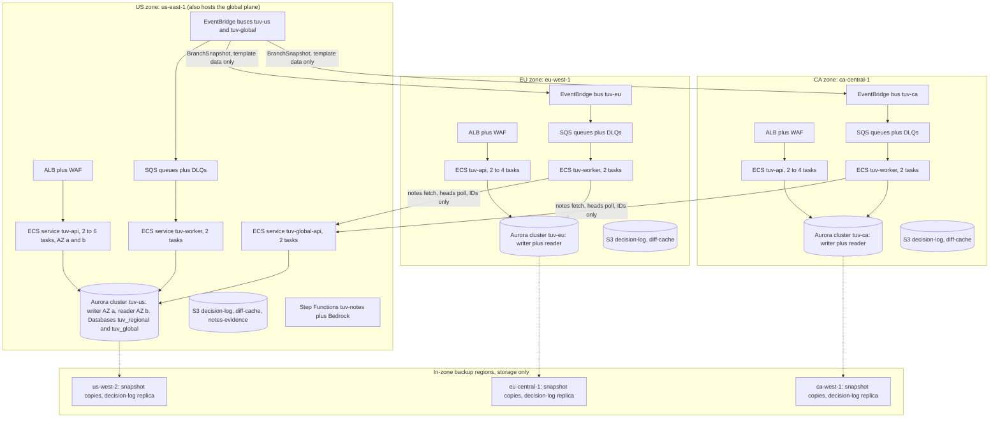

Physical names:

| Resource | Names |
|---|---|
| Aurora clusters | `tuv-us`, `tuv-eu`, `tuv-ca` (Aurora PostgreSQL 16, Aurora Standard storage) |
| Queues | `tuv-{zone}-engagement-events`, `tuv-{zone}-assignment-events`, `tuv-{zone}-graph-snapshots`, `tuv-global-template-events`, each with `-dlq`. All SQS **standard**; §10 explains why FIFO is not needed. |
| KMS | One customer-managed key per zone. Evidence manifests are signed with an asymmetric key in us-east-1. |
| Singletons inside `tuv-worker` | Dispatcher, reconciler and sweeper run behind `pg_try_advisory_lock` leader election. |

### 8.2 Store selection (D-24)

| Criterion | Serverless: DynamoDB on-demand + Lambda + EventBridge/SQS | Provisioned: Aurora PostgreSQL + ECS Fargate (**chosen**) |
|---|---|---|
| Derive-on-read join (K-1) | No joins. Deriving per firm means reading every item: 40,000 × ~0.4 KB = 16 MB at 1 MB per Query page, so ≥ 16 sequential round trips. Fails NFR-4 (≤ 300 ms aggregates). | Hash join over ≤ 40,000 rows: ~20–40 ms |
| Therefore forced to | Fan out on publish (T-1 rejected), plus counter items per firm and per user | Derive on read |
| Hot keys | Firm counter item takes ~20,000 updates per publish for a large firm. At ≤ 1,000 WCU/s per partition that is ≥ 20 s, which breaks NFR-1 unless counters are pre-aggregated in the writer. | n/a |
| Filter × sort × paginate combinations (FR-1.3) | One GSI per sort and filter combination; sparse-GSI workarounds | Single composite index plus an in-query predicate |
| Atomic decision + index + outbox + write-back op | `TransactWriteItems`, ≤ 100 items, so bulk must be chunked | One SQL transaction |
| Fair queue with leases | Conditional writes plus a scan; awkward | `FOR UPDATE SKIP LOCKED` |
| Monthly platform cost at AS-10 (§16) | ~$1,451 on-demand / ~$1,421 committed | ~$2,521 on-demand / ~$2,024 committed |
| Cost sensitivity | Linear in requests at ~$2.28 per 1M | Flat until capacity; crossover at ~2.0× (committed) to ~2.7× (on-demand) the assumed traffic (§16.5) |
| Ops | No servers; many functions | Cluster upgrades, connection pooling (RDS Proxy not needed at this scale) |

**Decision.** Aurora PostgreSQL with ECS Fargate in every zone. The read requirements (FR-1.3, FR-1.8, NFR-4) need relational joins and ad-hoc predicates. The correctness model needs multi-row transactions (I-6). Serverless is cheaper by ~$603–1,070/month at the assumed traffic. It buys that saving with fan-out, counters and a second copy of the offer logic, and those are where correctness defects would come from. Rejected variant: Aurora Serverless v2. It has the same query shape and is cheaper for EU and CA (§16.6, option O-1). It is deferred until load tests confirm the minimum ACU sizing.

### 8.3 Residency rules (NFR-9, A-3, C-4)

| Data | May leave its zone? | Mechanism |
|---|---|---|
| Engagement IDs, names, firm IDs, user IDs, versions per engagement, decisions, assignments | **No** | Regional Aurora, regional S3. Backups copied only within the zone (us-west-2, eu-central-1, ca-west-1). Logs and traces stay in CloudWatch and X-Ray in the zone. |
| Template content, graph, notes | Enters zones from global | Branch snapshots; notes fetch by `version_id` |
| Diff requests | Only `(product_id, from_version, to_version)` with a service credential | Regional proxy strips user and firm identity (§5.3) |
| Operational metrics | Yes, as aggregates without firm, engagement or user identifiers: latencies, error counts, queue depths, count of unindexed engagements, counts per version with k ≥ 10 suppression | CloudWatch cross-region dashboard reads per-zone metrics |
| Cost | Yes | Cost Explorer by tags `feature=tuv`, `zone=…` |
| Inference input | Template diff only. The pipeline has no network route or IAM to regional databases (NFR-17). | Separate account or role, no peering to zones |

Aurora Global Database is **rejected** for distributing the graph because it replicates the whole cluster, which would carry US engagement data into other zones.

### 8.4 Routing

The JWT `zone` claim (AS-20) selects the zone endpoint. A token whose `zone` does not match the zone that received the request gets 421. Each `tuv-api` serves only firms that live in its zone; `firm_rollout` holds the firm-to-zone list.

---

## 9. Key flows

### 9.1 Publish with notes review gate

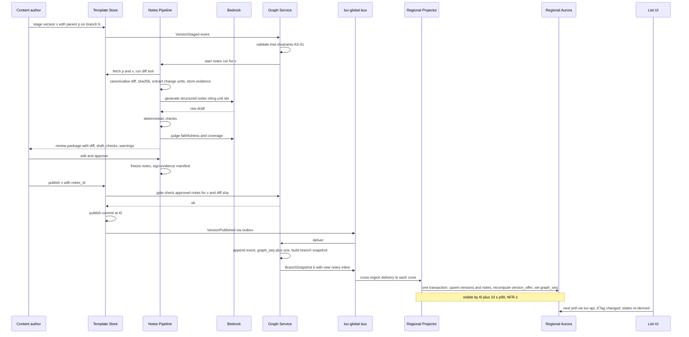

### 9.2 Withdraw

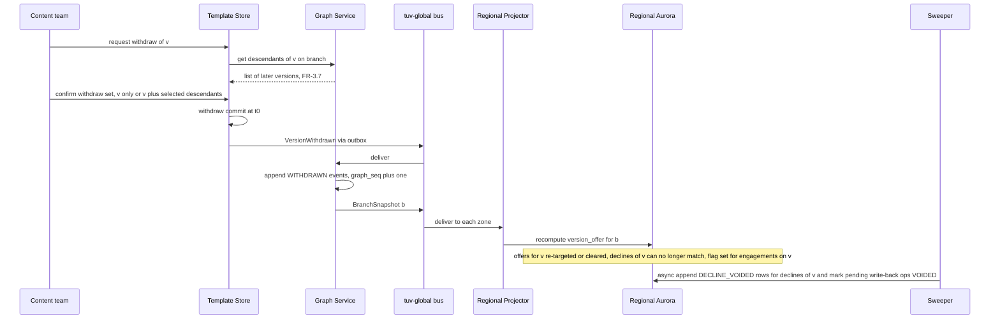

### 9.3 Backfill and capture-on-load

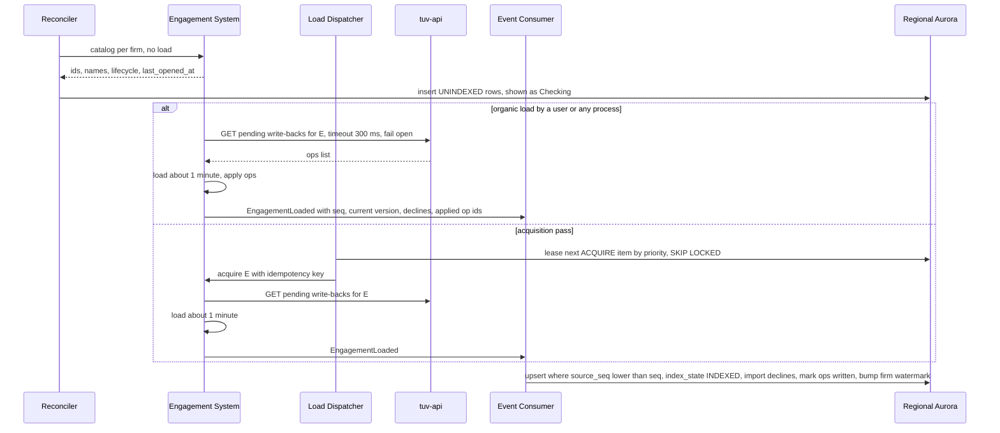

### 9.4 Decline without load, then write-back (FR-4.9, FR-4.4)

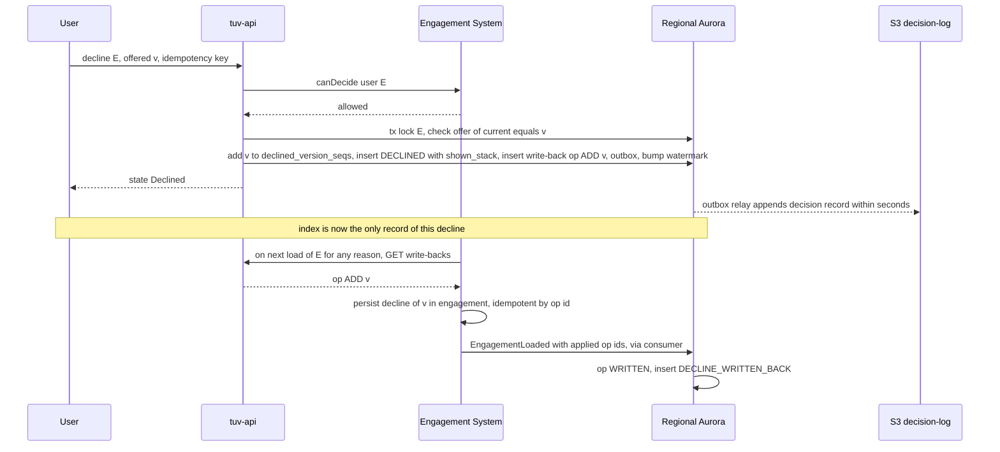

If the user reverses the decline while v is still the offer (FR-4.4), the op is either cancelled (if still pending) or followed by a `REMOVE v` op (if already written).

### 9.5 Apply (FR-4.1, FR-4.2, FR-4.7)

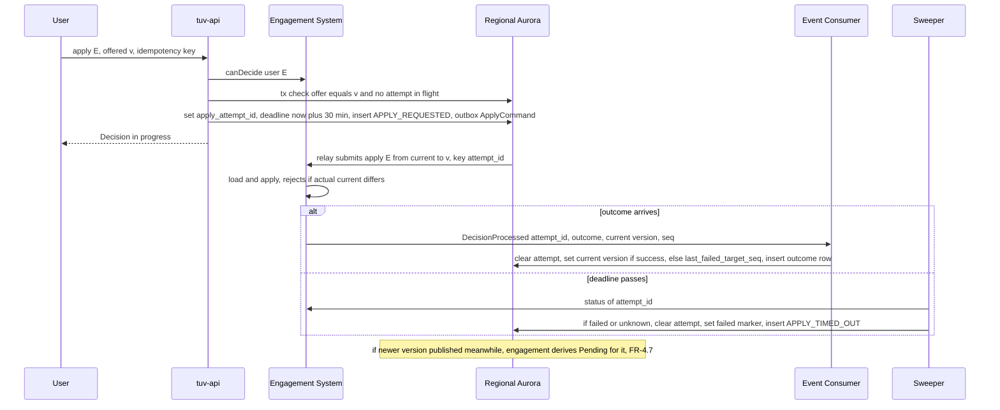

### 9.6 Bulk apply (FR-4.6, FR-4.8, NFR-19)

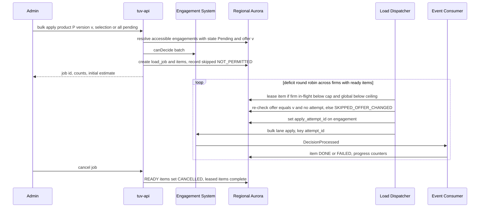

---

## 10. Event delivery and reconciliation

Every event uses the same envelope: `{event_id, source, type, aggregate_id, aggregate_seq, occurred_at, schema_version, payload}`.

Delivery is at least once and may duplicate, reorder, delay or lose events (C-8). SQS standard queues are used everywhere. Ordering is handled by sequence-conditional writes, not by the transport, which keeps cross-region EventBridge targets and throughput simple.

| Event | Path | Idempotency key | Ordering | Gap detection | Reconciliation | Damage if lost, and its bound |
|---|---|---|---|---|---|---|
| `VersionPublished` / `Withdrawn` (TS) | TS outbox → `tuv-global` → `tuv-global-template-events` → Graph Service | `(product_id, ts_seq)` | Apply next `ts_seq` only; buffer gaps | `ts_seq` jump triggers list-since from TS (AS-03) | Graph Service polls TS heads every 60 s | Publish or withdraw invisible for ≤ 60 s plus propagation. A withdraw breaches NFR-2 by ≤ ~70 s and pages on-call. |
| `BranchSnapshot` (global → zone) | Outbox → `tuv-global` → rule → `tuv-{zone}` → `graph-snapshots` | `(branch_id, graph_seq)` | **State transfer**: apply only if `graph_seq` is greater; stale or duplicate is a no-op | n/a (full state) | Each zone polls `GET /graph/heads` every 60 s and pulls any branch that is behind | ≤ 60 s staleness. Notes are fetched before commit (I-3). |
| `EngagementCreated` | ES bus → `engagement-events` | `(engagement_id, engagement_seq)` | Seq-conditional upsert | n/a | Hourly catalog diff | Unknown engagement shows **Checking**, never Up to date (I-7). ≤ 1 h, then indexed from the catalog-provided version, or acquired. |
| `EngagementLoaded` (state snapshot) | Same | `(engagement_id, engagement_seq)` | Seq-conditional | A seq gap is harmless because the snapshot is complete | Next load; drift-audit sample | Index is stale until the next load. Measured by the drift SLI (§17). |
| `DecisionProcessed` (from our command) | Same | `attempt_id` | Seq-conditional for `current_version` | n/a | Sweeper status check at the deadline (AS-17) | Shows In progress ≤ 30 min, then resolved by the status query. A late success is accepted (ES wins) and logged as `APPLY_LATE_OUTCOME`. |
| `DecisionProcessed` (made outside this UI, AS-24) | Same | `(engagement_id, engagement_seq)` | Seq-conditional | Gap on the next event | Next load | Offer may be stale. A decision against it is rejected by ES (AS-06), which then emits the true state. |
| `LifecycleChanged` / `EngagementDeleted` | Same | `(engagement_id, engagement_seq)` | Seq-conditional | n/a | Hourly catalog | Archived engagement still counted ≤ 1 h (FR-1.7). Deleted engagement's history removed ≤ 1 h later (D-28). |
| `AssignmentChanged` | ES bus → `assignment-events` (separate queue so revokes are never stuck behind load events) | `(firm_id, assignment_seq)` | Per-firm seq; out-of-order events are held | A seq gap triggers a full firm assignment reload (AS-05) | Hourly per-firm digest comparison | A lost revoke exposes indicator metadata for ≤ 1 h. Decisions are never exposed because they re-check `canDecide` live (FR-4.5). |
| Outbox → ES commands (`ApplyCommand`, `AcquireCommand`) | Relay → ES API | `attempt_id` | n/a | n/a | Lease expiry re-sends with the same key | ES deduplicates by key (AS-06) |

**Consumer mechanics**

| Mechanism | Behaviour |
|---|---|
| Inbox and processing | An `inbox` insert (PK `event_id`, `ON CONFLICT DO NOTHING`) and all effects run in **one transaction**. |
| Retries and DLQ | `maxReceiveCount = 5`. DLQ retention 14 days. An alarm fires on any visible DLQ message. Redrive tooling is available. A poison event whose `engagement_id` can be parsed marks that engagement `needs_verify`, which enqueues a low-priority ACQUIRE. |
| Relay | Outbox rows are polled every 100 ms with `SKIP LOCKED`. Alarm fires when the oldest unpublished row is older than 30 s. |
| ES-side defence | ES rejects apply or decline when the actual current version ≠ `from_version` (AS-06). Index staleness therefore cannot corrupt an engagement; it can only cause a rejected decision. |

---

## 11. Load Dispatcher: bulk decisions and the MVP worker

### 11.1 Work classes

| Lane | Kind | Source | Weight | Notes |
|---|---|---|---|---|
| L1 | `BULK_APPLY` | FR-4.6 | 60% | Pinned to `(product, version)`, FR-4.8 |
| L2 | `ACQUIRE_PRIORITY` | Backfill items opened in the last 30 days, or whose product has just been published | 25% | FR-5.3 prioritisation |
| L3 | `ACQUIRE_BACKGROUND`, `DRIFT_AUDIT` | Remaining backfill; 0.1% daily sample | 15% | Drift SLI (§17) |
| L4 | `WRITEBACK_FLUSH` | Only on decommission or rollback (§12.4) | Uses unused share | |

Single interactive applies **bypass** the Dispatcher. They go straight to ES's interactive path (C-7), as they do today. Bulk declines **bypass** it too because they need no load (FR-4.9). They run as chunked transactions of 500 items, each re-checking the offer; 40,000 items take < 30 s.

### 11.2 Scheduling

| Element | Rule |
|---|---|
| Scheduler | Deficit round robin over firms that have READY items, within lane weights, quantum = 1 item |
| Per-firm cap (`K_firm`) | Default 50 concurrent loads (configurable per firm). Bounds a 40,000-engagement firm at 13.3 h (§14.5). |
| Global concurrency (`N`) | `min(N_ceiling, N_health)`. `N_health` uses AIMD: +5 every 5 min while load-pool and engagement-system health is green; ×0.5 on HTTP 429, on ES interactive load p95 > baseline × 1.2, or on pool saturation. |
| Monthly ceiling | `dispatcher_budget.load_minutes_used` vs `ceiling`. At 80%, alert and cap `N` at the floor (10). At 100%, only L1 continues, at the floor. |
| Autoscale signal | Publishes the CloudWatch metric `tuv/dispatcher/demand_inflight` per zone. The dedicated pool scales on it between 0 and 100 pods (AS-08). |
| Lease | `lease_until = now + 5 min`. Renewed while ES reports progress. When it expires, the item is re-dispatched **with the same `attempt_id`**. |
| Item terminal states | DONE, FAILED (after 3 attempts), SKIPPED_OFFER_CHANGED, SKIPPED_NOT_PERMITTED, CANCELLED |
| ETA | `remaining / EWMA(items completed per minute for this firm)`, shown as a range (p50–p90) |

### 11.3 Bulk-apply guarantees (FR-4.8)

1. The job is pinned to `(product_id, version_seq)`. Every item re-checks `offer = version_seq` at dispatch time, not only when the job is created.
2. Permission is checked in a batch when the job is created and enforced again by ES at apply time.
3. Cancelling moves READY items to CANCELLED. Leased items complete, and their outcomes are recorded.
4. Progress shows `{done, failed, skipped_offer_changed, skipped_not_permitted, cancelled, remaining}`.

### 11.4 Interactive protection (NFR-19)

- Bulk work runs on the dedicated low-priority pool (AS-08), never on interactive pods.
- The Dispatcher also backs off on ES interactive latency, which covers resources the two pools share, such as the ES database.

### 11.5 Mapping the Java MVP "template-publish fan-out worker"

**The tension.** Under K-1 a publish needs no per-engagement work. The naive reading, "load every affected engagement on publish", costs 20,000 load-minutes = 333 pod-hours per publish, or ~57,700 pod-hours per month (§14.1). That is about four complete backfills every month and misses NFR-1 by roughly three orders of magnitude. The architecture therefore does **not** add per-engagement loads to the publish path.

**The honest mapping.** The MVP's properties are:
- one triggering version
- a large set of engagements
- a ~1-minute downstream call per engagement
- another team's limited capacity

In this architecture those properties belong to the **Load Dispatcher (§11)**. Its most direct publish-triggered job is **"apply version v of product P to all pending engagements"** (FR-4.6/4.8), which is a fan-out of one published version across many engagements into the dedicated load pool. During rollout, a publish also triggers L2 acquisition boosts for unindexed engagements of that product. The MVP should be written as the Dispatcher core, with the job source kept pluggable:

| MVP concern | Dispatcher contract |
|---|---|
| Concurrency | `CapacityLimiter`: a global semaphore with AIMD plus one semaphore per firm |
| Fairness | `FairScheduler`: deficit round robin across firms |
| Idempotency | `attempt_id` per item, reused on retry. ES deduplicates by key (AS-06). Item state transitions are compare-and-set. |
| Failure | Leases, bounded retries with jittered backoff, a FAILED terminal state, resumable after a crash |
| Downstream capacity | Async submit plus completion event or status poll. 429s and health signals reduce `N`. Monthly ceiling. |
| Correctness | Re-check the pin (`offer = v`) at dispatch time; skip with a reason |
| Interfaces | `JobSource`, `ItemStore` (lease, complete, skip), `EngagementGateway` (submit, status), `CompletionListener`, `CapacityLimiter`, `FairScheduler` |

---

## 12. Migration, backfill and rollout

### 12.1 Phases

| Phase | Action | Exit criterion |
|---|---|---|
| P0 Shadow | Deploy ES hooks (AS-04 to AS-07), consumers and the projector. Seed the index from the catalog with every engagement UNINDEXED. Create and Loaded events start filling rows. No UI. | Event lag p99 < 5 s, DLQ empty for 7 days |
| P1 Capture-on-load | The write-back endpoint is live. Every organic load captures state (FR-5.4). | n/a |
| P2 Acquisition pass | Dispatcher L2 and L3, throttled (§14.4). Priority = `last_opened_at DESC` within the current firm wave. | Firms in the wave ≥ 95% indexed |
| P3 Firm enablement | `firm_rollout.state`: OFF → ACQUIRING → VISIBLE. Waves: internal test firms, then 50 median firms, then 10% of firms, then all small and medium firms, then the 20 largest, one at a time. | Firm ≥ 95% indexed. Remaining rows show Checking (FR-1.5). |
| P4 Steady state | Drift audit, reconcilers | Unindexed active engagements older than 1 h = 0 |

### 12.2 What users see during the pass

| Situation | Behaviour |
|---|---|
| Firm in OFF or ACQUIRING | The list renders as today, with no indicators |
| Firm VISIBLE | Unindexed rows show **Checking for updates**. Counts show `pending N, checking M` separately. Checking rows are never counted as up to date (FR-1.5, I-7). |
| User opens an unindexed engagement | Its load captures state, so the row becomes accurate seconds after the session starts |

### 12.3 A publish during the backfill

- Indexed engagements derive the new offer immediately (§6). The publish needs no knowledge of the backfill.
- Unindexed engagements stay Checking. If the catalog provides a template ID, their items for that product are promoted to L2.
- A capture that arrives after the publish derives against the current graph, so no publish is missed.
- A capture and an apply event racing each other are resolved by `engagement_seq` (I-9).

### 12.4 Cut-over and rollback

| Topic | Approach |
|---|---|
| Cut-over | There is no predecessor system. Cut-over is per-firm UI enablement. |
| Rollback, UI | Set the firm to OFF. Consumers, capture and write-back keep running, so state stays correct for re-enablement. |
| Rollback, full decommission | The index is the only record of declines not yet written back (FR-4.9). Before decommissioning, run `WRITEBACK_FLUSH` jobs (L4) for every engagement with a pending op: one load each. Cost = count of pending-op engagements × 1 load-minute. The flush is a mandatory runbook step, gated by `count(writeback_op WHERE state='PENDING') = 0`. |
| Schema changes | Expand-and-contract migrations only. Event `schema_version` is used, and consumers accept both N and N+1. |

---

## 13. Release notes: generation, evaluation and audit defence

### 13.1 Pipeline (Step Functions `tuv-notes`; FR-2.5, FR-2.6, NFR-3)

| Step | Action | Output stored |
|---|---|---|
| S1 Diff | Run the existing diff tool on (parent p, staged v). Canonicalise: sorted keys, normalised whitespace, RFC 6901 pointers. | `diff.json.gz`, `diff_sha256`, diff tool version, archive sha256 of p and v |
| S2 Change units | Split into units `{unit_id, pointer, op, before, after}`. Values are truncated to 2 KB with hashes of the full value. Deterministic noise rules (reordering, IDs, formatting) mark units `noise`. Path-pattern rules per market mark `material_candidate` (for example calculation, procedure and regulatory-reference paths). | `units.jsonl`, preprocessor version, rule-set version |
| S3 Generate | Bedrock, pinned model ID (default `anthropic.claude-sonnet-5-5`, CL-3; tiering in §13.7), fixed effort setting, no sampling parameters (current Claude models reject `temperature`), JSON-schema structured output `{headline, items:[{text, material, unit_ids[]}], uncovered_unit_ids[]}`, written in the branch market's language (D-25). The prompt contains units only, no engagement or firm data (NFR-17, FR-2.4). | Rendered prompt, prompt ID@version, model ID, parameters, request ID, raw response, token counts |
| S4 Deterministic checks | See §13.2 | Check report |
| S5 Judge | A different model family scores each item as supported, partially supported or unsupported against its cited units, and lists material-candidate units it judges undescribed | Judge model ID, prompt version, raw output |
| S6 Author review | Side-by-side view: items, cited units highlighted, uncovered units, warnings. Author edits and approves (D-13). | Edit events `(who, when, before, after)`, approver, approval timestamp, overrides with reasons |
| S7 Freeze | Notes become immutable (D-15). The manifest of all artefact hashes is signed with KMS. The publish gate is armed for `(version, diff_sha256)` (AS-02). | `manifest.json`, signature, `content_sha256` |

If the staged content changes after S1, `diff_sha256` changes, the approval no longer matches, and the gate refuses the publish.

### 13.2 Automated checks before human review

| Check | Rule | Effect |
|---|---|---|
| Schema | Output parses against the JSON schema | Fail: regenerate (max 2), then manual |
| Citation validity | Every cited `unit_id` exists | Hard fail: hallucinated citation |
| Citation presence | Every item cites ≥ 1 unit | Hard fail |
| Material coverage | Every `material_candidate` unit is cited, or the author explicitly marks it "not material" with a reason | Approval blocked until resolved (NFR-16) |
| Unit coverage | ≥ 90% of non-noise units cited | Warning |
| Literal grounding | Every number, date, code or quoted identifier in an item appears in the before or after values of its cited units | Warning per item |
| Judge: unsupported item | Any item scored unsupported | Approval blocked until edited or overridden with a reason |
| Language | Detected language matches the market language | Fail: regenerate |
| Scope | No second-person or engagement-referencing phrasing (pattern list, for example "your engagement", "your client's balances") | Warning (FR-2.4) |
| Length | Headline ≤ 120 characters; ≤ 40 items | Warning |

### 13.3 Large diffs

| Diff size (tokens) | Strategy |
|---|---|
| ≤ 60k | Single call |
| 60k to 600k | Map-reduce by top-level template section: one call per section of ≤ 50k tokens, then a reduce call for the headline and de-duplication. Citations are preserved, and S4 runs on the merged output. |
| > 600k, or > 5,000 non-noise units | **Bulk-change mode**. Deterministic per-section summaries ("N changes in section X", with the affected item names listed). The LLM produces the headline and per-section text only. The review UI requires the author to write material items by hand. |

### 13.4 Model or prompt changes, and provider failure

| Event | Handling |
|---|---|
| Prompt or model change | Prompts are versioned in git (`prompt_id@semver`). A candidate runs on the golden set and must meet all thresholds in §13.5 without regression. It then runs in shadow on the next 10 live versions, generating alongside the current model while authors see only the current draft. After that it is promoted. Published notes are **never regenerated**. |
| Model deprecation | Has no effect on published notes. Reproduction uses stored artefacts, not re-inference (§13.6). |
| Provider outage or throttling | Retry with jittered backoff (3 attempts), then fail over to a pre-qualified second model on Bedrock, then manual authoring in the review UI with `generation_mode = MANUAL`. Publishing is delayed, not blocked. The read path is unaffected (FR-2.5, NFR-3). |

### 13.5 Evaluation

| Layer | Metric | Threshold / use |
|---|---|---|
| Offline golden set | ~200 historical diffs, stratified by market, language and size, with expert-labelled material units and approved reference notes. Refreshed quarterly. | Release gate for prompt or model changes |
| Deterministic | Citation validity | = 100% |
| Deterministic | Material-unit recall (labelled material units cited) | ≥ 98% |
| Deterministic | Literal-grounding violations per 100 items | ≤ 1 |
| Judge | Unsupported-item rate | ≤ 1% |
| Judge calibration | Agreement with human labels on the golden set (Cohen's κ) | ≥ 0.8, re-measured quarterly. Below that, the judge stays advisory only. |
| Online, author | Edit rate (items changed / items), add rate (omission proxy), delete rate (hallucination or noise proxy), override rate, time to approve | Trend dashboard. A sustained rise triggers prompt review. |
| Online, user | "Report a problem with these notes" rate; details-view open rate after reading notes | Trust signal |
| Escape rate | Corrective versions published because notes were wrong (T-9) | Key quality KPI, target 0 per quarter |

### 13.6 Defending a March summary in November

**Per version, global, immutable.** Stored in S3 `tuv-global-notes-evidence` under Object Lock compliance mode for 10 years (AS-19). The manifest is KMS-signed and indexed in `g_notes`.

| Artefact | Content |
|---|---|
| Identity | `version_id`, parent, product, branch, market, language |
| Inputs | Archive sha256 of parent and version; diff tool version; canonical diff and `diff_sha256`; units, preprocessor and rule-set versions |
| Generation | Exact model ID, parameters, prompt ID@version, full rendered prompt, request ID, raw response, timestamps. Map-reduce intermediates where used. |
| Checks | Deterministic check report; judge model ID, judge prompt version, raw judge output |
| Human | Every edit event, overrides with reasons, approver identity, approval timestamp |
| Result | Final notes JSON, `content_sha256`, `notes_id` |
| Graph | Template Store publish commit time and event ID. Withdrawal events (who, when, reason) are appended to `g_version_event`, which is never updated. |

**Per decision, regional.** `decision.shown_stack` records `[{version_seq, notes_sha256, withdrawn, declined}]` exactly as rendered, plus `graph_seq_at` and the UI renderer version.

**Reproduction procedure** (`tuv-audit reproduce --engagement E --at T`, run inside the engagement's zone):

1. `engagement_version_history` and `decision` give the index's current version and declines at T.
2. `g_version_event` filtered to `at ≤ T` gives the branch state and withdrawn flags as of T. Replaying `recompute` gives the offer at T and the stack path.
3. Notes are fetched by version and their hashes verified against the signed manifests.
4. If a decision exists, compare with `shown_stack`. They must match exactly.
5. Render with the UI renderer version recorded at T.

**Caveat, stated plainly.** The reproduction shows what the **index believed** at T. If the index was stale against ES at T, the record shows that, and ES history is the source for the engagement's actual version (FR-5.5).

### 13.7 Model selection and tiering

The task is narrow: turn a list of change units into structured items that cite those units. Every output passes the deterministic gates (§13.2), a judge, and a human approver before it is published. That is why a mid-tier model is the default and the most capable tier is kept for escalation only.

| Tier | Model (Bedrock ID) | Used for | Input / output per 1M tokens | Cost per version (§14.6 token counts) | Per month, including evaluation |
|---|---|---|---|---|---|
| **Default** | Claude Sonnet 5.5 (`anthropic.claude-sonnet-5-5`) | Generation, the reduce step for large diffs, and the judge's price point | $2.00 / $10.00 | $0.302 | **$173.05** |
| Economy candidate | Claude Haiku 5.5 (`anthropic.claude-haiku-5-5`) for generation and the per-section map step; Sonnet 5.5 for the judge | Same pipeline | $0.10 / $0.50 (prompts up to 100k tokens; $0.50 / $2.50 beyond) | 55,900 × $0.10 + 6,600 × $0.50 + 45,000 × $2.00 + 3,400 × $10.00, all per 1M = $0.133 | $76.15 |
| Escalation | Claude Opus 5.5 (`anthropic.claude-opus-5-5`) | Regeneration when a draft fails the gates twice, and bulk-change mode (§13.3) | $4.00 / $20.00 | $0.604 | About $5 extra at 10% of versions (17 × ($0.604 − $0.302)) |

Prices are Anthropic list prices used as a stand-in for Bedrock's partner pricing (§16.1). The cost model uses the default tier.

**Rules.**

| Rule | Reason |
|---|---|
| A tier is used in production only after it meets every threshold in §13.5 on the golden set, per language. Sonnet 5.5 is the planned default, not a measured result; the golden-set run decides. | "Good enough" is defined by the evaluation, not by the price list |
| The economy tier is promoted only through the shadow procedure in §13.4. If it fails in some languages, it is used only where it passes. | Small models degrade unevenly across languages (D-25) |
| The judge is never a weaker model than the generator. S5 prefers a different model family at a comparable price; the cost model prices it at the default tier. | A weaker judge misses the generator's errors |
| The Haiku map step stays under 100k tokens per call, which the 50k-token section limit in §13.3 already guarantees. | Avoids the higher price band |
| The evidence bundle records the exact model ID per call (§13.6), so mixed tiers remain auditable. | November defence |

What tiering does not change: inference is 4.6% of the all-in monthly figure at the default tier (§16.7). Moving to the economy tier saves about $97 a month. The decision should rest on author edit rate (§13.5), not on that saving.

### 13.8 Price comparison across providers

Prices are per 1M tokens, standard (non-batch) rates, read from each provider's own pricing page on 2026-11-12. The cost columns apply the token counts of §14.6 unchanged: 101,000 input and 10,000 output tokens per version, and 573 runs a month (173 versions plus 400 evaluation cases).

| Tier | Provider | Model | Input / output per 1M | Cost per version | Per month | Notes |
|---|---|---|---|---|---|---|
| Top | Anthropic | `Claude Opus 5.5` | $4.00 / $20.00 | $0.604 | $346.09 |  |
| Top | OpenAI | `gpt-6-astra` | $10.00 / $50.00 | $1.510 | $865.23 |  |
| Top | Google | `gemini-4-carbon` | $2.00 / $10.00 | $0.302 | $173.05 | $4.00 / $20.00 from 2026-12-01, which doubles the figures |
| Top | Moonshot (Kimi) | `kimi-k3` | $3.00 / $15.00 | $0.453 | $259.57 |  |
| Top | DeepSeek | `deepseek-v4-pro` | $1.32 / $3.96 | $0.173 | $99.08 | Peak rate. Off-peak is half ($0.66 / $1.98) |
| Mid | Anthropic | `Claude Sonnet 5.5 (design default)` | $2.00 / $10.00 | $0.302 | $173.05 |  |
| Mid | OpenAI | `gpt-6.1-sol` | $2.00 / $10.00 | $0.302 | $173.05 | The page mentions promotional Sol pricing until 2026-11-30 |
| Mid | Google | `gemini-4-hydrogen` | $1.50 / $7.50 | $0.226 | $129.78 |  |
| Mid | Moonshot (Kimi) | `kimi-k3.1-pro` | $2.00 / $10.00 | $0.302 | $173.05 |  |
| Mid | OpenAI | `gpt-6.1-terra` | $1.00 / $5.00 | $0.151 | $86.52 |  |
| Economy | Anthropic | `Claude Haiku 5.5` | $0.10 / $0.50 | $0.015 | $8.65 | Prompts up to 100k tokens; $0.50 / $2.50 beyond |
| Economy | OpenAI | `gpt-6-luna` | $0.10 / $0.50 | $0.015 | $8.65 |  |
| Economy | Google | `gemini-3.8-flash` | $0.75 / $3.75 | $0.113 | $64.89 | $1.50 / $7.50 from 2027-01-01 |
| Economy | Google | `gemini-3.5-flash-lite` | $0.30 / $2.50 | $0.055 | $31.69 |  |
| Economy | DeepSeek | `deepseek-flash` | $0.30 / $1.20 | $0.042 | $24.24 | Peak rate. Off-peak is half ($0.15 / $0.60) |

Sources: Anthropic model list (cached 2026-11-03); `developers.openai.com/api/docs/pricing`; `ai.google.dev/gemini-api/docs/pricing`; `platform.kimi.ai/docs/pricing/chat`; `api-docs.deepseek.com/quick_start/pricing`.

**Reading the table.**

| Point | Detail |
|---|---|
| The spread is small in absolute terms | Cheapest to dearest is about $9 to $865 a month. The design default is $173. Inference stays under 5% of the all-in figure for every mid-tier and economy option. |
| The figures are not like-for-like | Each provider tokenises differently and spends a different number of thinking tokens, which are billed as output. The same diff will not produce exactly 101,000 and 10,000 tokens on every model. Treat differences under about 30% as noise. |
| Batch pricing lowers all of these | OpenAI's batch rate is half the standard rate, Kimi's is 60%, and Anthropic's is half. The offline evaluation (400 of the 573 runs) can run as batch; production drafts could too, because authors do not need the draft within seconds. |
| Two prices are about to change | `gemini-4-carbon` doubles on 2026-12-01 and `gemini-3.8-flash` on 2027-01-01. Budget on the later price. |
| DeepSeek's price depends on the clock | Peak hours are 01:00–04:00 and 06:00–10:00 UTC on weekdays. Notes generation can be queued for off-peak hours at half price. |

**What price does not settle.**

| Constraint | Effect on the choice |
|---|---|
| CL-3 chose Amazon Bedrock | Claude is on Bedrock. OpenAI's pricing page states its models are also sold through Bedrock. Whether Gemini, Kimi and DeepSeek models are available there was not checked; using their own APIs means a second vendor contract, a second egress path and audit trail outside CloudTrail. |
| Vendor jurisdiction and data handling | Only template content is sent (NFR-17), and it is not firm-specific (C-5). It is still unreleased product content, so each vendor's retention and training-use terms need a compliance review before use. |
| Market languages (D-25) | Quality must be measured per language on the golden set (§13.5). A model that is cheapest in English may fail the thresholds in French or German. |
| The judge should come from a different model family | A second provider is useful here regardless of price: generation on Claude Sonnet 5.5 and the judge on a mid-tier model from another provider costs about the same as the default and gives an independent check. |
| Model lifetime | Evidence is kept 10 years (AS-19), but reproduction never re-runs the model (§13.6), so a retired model does not weaken the audit trail. |

**Recommendation.** Keep Claude Sonnet 5.5 on Bedrock as the generation default. Put two candidates through the golden set and the shadow procedure (§13.4): one mid-tier model from another provider as the judge, and one economy model (Claude Haiku 5.5 or `gpt-6-luna`, both about $9 a month) as a generation candidate. Promote on measured edit rate and material-change recall, not on the price column.

---

## 14. Scale arithmetic

### 14.1 Publish blast radius (NFR-7)

| Quantity | Formula | Value |
|---|---|---|
| Engagements per product | 800,000 / 40 | 20,000 |
| Publishes per month | 40/week × 4.33 | 173 (≈ NFR-8's ~170) |
| **Derive on read**: rows written per zone per publish | 1 version + 1 notes + V_b `version_offer` rows (≤ 200) + 1 `branch_state` | ≤ 203 |
| Derive on read: all zones, per publish | 203 × 3 | ≤ 609 |
| **Fan-out in Aurora**: rows per publish | 20,000 state rows (US share 14,000) + 80,000 per-user counter deltas (× 4, AS-13) | 100,000 |
| Fan-out in DynamoDB: WRU per publish | 20,000 × 3 (base + 2 GSIs) + 80,000 counters | 140,000 |
| **Naive per-engagement load on publish** | 20,000 × 1 min | 20,000 load-min = 333.3 pod-h |
| Naive: duration at 100 parallel loads | 20,000 / 100 | 200 min (NFR-1 is 10 s) |
| Naive: monthly pod-hours | 333.3 × 173 | 57,667 pod-h (4.3 × full backfill) |
| Naive: monthly cost | 57,667 × P-32 (blended) | $6,786 |

### 14.2 NFR-1 latency budget (p99, server-side, from publish commit)

| Step | Budget |
|---|---|
| TS outbox → `tuv-global` bus | 1.0 s |
| Graph Service consume, transaction, outbox | 1.0 s |
| Relay → global bus → cross-region bus (to verify) | 2.5 s |
| Regional SQS long poll → projector | 0.5 s |
| Notes fetch. Usually 0 s because notes for the new version are carried inline in the snapshot; this is the fallback path. | 1.0 s |
| Projector transaction (≤ 203 rows) | 0.3 s |
| Visible to the next API read (state derived; ETag includes `graph_seq`) | 0 s |
| **Total** | **6.3 s** (headroom 3.7 s) |
| Polling lag on open pages (D-17, excluded from NFR-1) | ≤ 30 s |

Withdraw (NFR-2) uses the same path and the same budget.

### 14.3 Read traffic (D-17 polling dominates)

| Quantity | Formula | Value |
|---|---|---|
| Polls per page-hour | 3,600 / 30 | 120 |
| Business-hours polls/month | 8,000 × 120 × 220 | 211,200,000 |
| Off-hours polls/month | 600 × 120 × 510 | 36,720,000 |
| Total polls/month | | 247,920,000 |
| Other calls (AS-11) | 10% | 24,792,000 |
| **Total requests/month** | | **~272.7 M** |
| Peak poll rate | 20,000 / 30 | 667 rps |
| Peak total | 667 × 1.1 | 733 rps |
| US / EU / CA requests per month | × 0.7 / 0.2 / 0.1 | 190.9 M / 54.5 M / 27.3 M |
| US / EU / CA peak | | 513 / 147 / 73 rps |

**Poll cost control.** The ETag is `W/"{firm_change_seq}.{zone_graph_seq}.{user_assignment_seq}"`. An unchanged ETag returns 304 after one primary-key read. Poll intervals get ±20% jitter to spread the post-publish burst. After a publish, every ETag changes. The worst-case recompute burst is 667 qps of per-user queries (US share 467 qps): about 1–3 ms each for a median user and ~30 ms for an admin of the largest firm. At ~2 ms that is about 0.9 vCPU on the US reader, which has 2 (db.r6g.large). This is the figure the load test in §6.6 must confirm.

**Effect on D-24.** Request volume is the only metric that scales the serverless bill, at ~$2.28 per 1M requests (§16.5). The provisioned bill stays flat until capacity is reached. The 30-second polling decision is therefore the main factor that narrows the price gap: 91% of all requests are polls.

### 14.4 Backfill (NFR-13, FR-5.3)

| Quantity | Formula | Value |
|---|---|---|
| Load-minutes | 800,000 × 1 | 800,000 |
| Pod-hours | 800,000 / 60 | 13,333 |
| Duration at N = 50 | 800,000 / 50 min | 16,000 min = 266.7 h = 11.1 days |
| Duration at N = 100 | 800,000 / 100 | 8,000 min = 133.3 h = 5.56 days |
| Duration at N = 200 | 800,000 / 200 | 4,000 min = 66.7 h = 2.78 days |
| With 30% organic capture (AS-16), N = 100 | 560,000 / 100 | 5,600 min = 93.3 h = 3.89 days |
| Share of the dedicated pool, N = 100 | 100 / 100 (AS-08) | 100% (US 70, EU 20, CA 10). Bulk applies queue behind it unless N is lowered (§14.7). |
| One-off compute, worst case | 13,333 × P-32 (blended $0.117672) | $1,568.96 |
| One-off compute with organic capture | 9,333 × P-32 (blended) | $1,098.27 |

**Schedule.** The acquisition lanes may use the whole pool when no bulk apply is queued. Lane weights (§11.1) hand 60% of it back to bulk applies as soon as one arrives, and AIMD lowers N if the engagement system's shared database or control plane degrades.

### 14.5 Bulk apply, largest firm (NFR-19, T-8)

| Quantity | Formula | Value |
|---|---|---|
| Load-minutes | 40,000 × 1 | 40,000 |
| Pod-hours | 40,000 / 60 | 666.7 |
| Duration at K_firm = 20 | 40,000 / 20 | 2,000 min = 33.3 h |
| Duration at K_firm = 50 (default) | 40,000 / 50 | 800 min = 13.3 h |
| Duration at K_firm = 100 | 40,000 / 100 | 400 min = 6.7 h |
| Compute | 666.7 × P-32 (US $0.11652) | $77.68 |
| Bulk decline, 40,000 | 80 transactions × 500 rows | < 30 s, no loads |

### 14.6 Inference (NFR-8)

| Quantity | Formula | Value |
|---|---|---|
| Versions per month | 40/week × 4.33 | 173 |
| Generation input per call | mean diff 40k (AS-15) + 3k instructions | 43,000 tokens |
| Generation calls per version, including retries | | 1.3 |
| Judge input per call | 43,000 + 2,000 draft | 45,000 tokens |
| Input tokens per version | 43,000 × 1.3 + 45,000 | 100,900 ≈ 101,000 |
| Output tokens per version | visible 2,000 × 1.3 + 1,500 = 4,100, plus a thinking allowance of 5,900 (thinking is billed as output) | 10,000 |
| Cost per version | 101,000 × P-30 / 1M + 10,000 × P-31 / 1M | $0.202 + $0.100 = $0.302 |
| Production inference per month | 173 × $0.302 | $52.25 |
| Offline evaluation per month | 2 runs × 200 cases × $0.302 | $120.80 |
| **Inference total per month** | | **$173.05** |
| Worst case: every diff at p99 size (400k tokens, AS-15) | 173 × (1,010,000 × P-30 + 30,000 × P-31) / 1M | $401.36 |

Inference scales with versions only, not with engagements, firms or pairs (NFR-8).

### 14.7 Steady-state decision volume and load-pool capacity

The brief asks every firm to apply or decline every update for every engagement. At one publish per product per week, that has consequences the index does not show.

| Quantity | Formula | Value |
|---|---|---|
| Offers per engagement per year | 1 per week (one product per engagement) | 52 |
| Decisions per year, all firms | 800,000 × 52 | 41,600,000 |
| Decisions per year, largest firm | 40,000 × 52 | 2,080,000 |
| Load-minutes per month if every offer is applied | 173 × 20,000 × 1 min | 3,460,000 |
| Pod-hours per month | 3,460,000 / 60 | 57,667 |
| Pods busy continuously | 3,460,000 / 43,800 min | 79.0 |
| Share of the dedicated 100-pod pool, if all applies were bulk | 79.0 / 100 | 79% |
| Planning case: 25% of applies are bulk (AS-26) | 0.25 × 57,667 | 14,417 pod-hours = 19.7 pods on average |
| Monthly pool ceiling (§11.2) | | 15,000 pod-hours = 900,000 load-minutes |

What this means for the design:

- **The load pool is the capacity limit of the feature, not the index.** The index handles a publish in O(versions). Acting on that publish costs one pod-minute per engagement.
- **The 100-pod pool cannot run the backfill and absorb heavy bulk applies at the same time.** During the acquisition pass the Dispatcher's lane weights (§11.1) decide who waits.
- **Applies already happen today (A-2) on interactive pods.** The feature moves part of that load to the pool; it does not create it. AS-26 is therefore the least certain number in the cost model, and the monthly ceiling exists to bound it.
- **Bulk decline is free of loads (FR-4.9).** A firm that declines by default costs seconds; a firm that applies everything costs hours every week.
- **Firm-wide auto-apply policies (X-10) would not reduce this load.** They would remove the human step, not the pod-minute.

---

## 15. Availability, durability and consistency

### 15.1 Read-path availability (NFR-11: 99.9% = 43.8 min per 43,800-min month)

The read path is serial within a zone. The global plane, ES, Bedrock and EventBridge are **not** on it.

| Component | Availability used (SLA or target) |
|---|---|
| ALB (multi-AZ) | 0.9999 |
| ECS Fargate service across 2 AZs | 0.9999 |
| Aurora PostgreSQL Multi-AZ | 0.9999 |
| Our code and deploys (internal target) | 0.9995 |
| JWT validation (local, JWKS cached 24 h) | 1.0 |
| **Product** | 0.9999 × 0.9999 × 0.9999 × 0.9995 = **0.99920**, i.e. 35.0 min/month expected, leaving 8.8 min of headroom |

**Degraded mode (NFR-11).** The list UI calls us with a 1 s client timeout. On failure it renders without indicators and hides the "pending" filter.

### 15.2 Durability and recovery

| Data | Protection | RPO |
|---|---|---|
| Regional Aurora | 6-way storage replication across 3 AZs; PITR with 35-day retention; daily snapshots copied to the in-zone backup region | AZ: 0; PITR: ~5 min; region loss: 24 h (snapshot) |
| Declines not written back and all decisions (sole record) | Outbox → `tuv-{zone}-decision-log` S3 (versioned, Object Lock governance), with Cross-Region Replication to the in-zone backup region | ≤ 1 min, including region loss |
| Rest of the index | Rebuildable from ES: capture on load, catalog, acquisition. Costs up to 13,333 pod-h. | n/a |
| Global notes and evidence | S3 Object Lock compliance mode, CRR to us-west-2; `tuv_global` PITR | ≤ 15 min (CRR), 0 for evidence already written |

### 15.3 Consistency model

| Path | Model |
|---|---|
| Graph → zone | Eventual. Monotonic per branch (I-4). ≤ 10 s p99. |
| ES → index | Eventual. Monotonic per engagement (I-9). ES wins for version. |
| Decisions | Strongly consistent against the zone's offer map at commit time (I-6), on the writer endpoint. ES re-validates (AS-06). |
| List and count reads | Reader endpoint; replica lag typically < 100 ms. The decision response returns the new state so the UI does not need read-your-writes on the next poll. |
| Cross-zone | None needed. No engagement is ever in two zones. |

---

## 16. Cost model

The brief gives no figure for $X (D-12). This section therefore states the monthly figure the design produces and what would have to change to lower it (§16.7).

### 16.1 Unit prices

Source "PL" = official AWS Price List file for that region (`pricing.us-east-1.amazonaws.com/offers/v1.0/aws/<service>/current/<region>/index.json`), read 2026-11-12. "NC" = list price not re-checked against a price list; verify before budgeting.

| ID | Item | Unit | us-east-1 | eu-west-1 | ca-central-1 | Source |
|---|---|---|---|---|---|---|
| P-01 | Aurora PostgreSQL db.r6g.large, on-demand | instance-hour | $0.260 | $0.286 | $0.286 | PL |
| P-02 | Aurora storage (Standard) | GB-month | $0.10 | $0.11 | $0.11 | PL |
| P-03 | Aurora I/O (Standard) | 1M requests | $0.20 | $0.22 | $0.22 | PL |
| P-04 | Aurora db.r6g.large, 1-year reserved, no upfront | instance-hour | $0.170 | $0.188 | $0.1817 | PL |
| P-05 | Fargate vCPU, Linux ARM | vCPU-hour | $0.03238 | $0.03238 | $0.03565 | PL |
| P-06 | Fargate memory, Linux ARM | GB-hour | $0.00356 | $0.00356 | $0.00389 | PL |
| P-05x | Fargate vCPU, Linux x86 | vCPU-hour | $0.04048 | $0.04048 | $0.04456 | PL |
| P-06x | Fargate memory, Linux x86 | GB-hour | $0.004445 | $0.004445 | $0.004865 | PL |
| P-07 | Application Load Balancer | hour | $0.0225 | $0.0252 | $0.02475 | PL |
| P-08 | ALB capacity unit | LCU-hour | $0.008 | $0.008 | $0.0088 | PL |
| P-09 | NAT Gateway | hour | $0.045 | $0.045 | $0.045 | NC |
| P-10 | NAT data processed | GB | $0.045 | $0.045 | $0.045 | NC |
| P-11 | EventBridge custom events | 1M events | $1.00 | $1.00 | $1.00 | PL |
| P-12 | SQS standard | 1M requests | $0.40 | $0.40 | $0.40 | PL |
| P-13 | CloudWatch Logs ingest | GB | $0.50 | $0.50 | $0.50 | NC |
| P-14 | CloudWatch custom metric | metric-month | $0.30 | $0.30 | $0.30 | NC |
| P-15 | CloudWatch alarm | alarm-month | $0.10 | $0.10 | $0.10 | NC |
| P-16 | WAF web ACL | month | $5.00 | $5.00 | $5.00 | NC |
| P-17 | WAF rule | rule-month | $1.00 | $1.00 | $1.00 | NC |
| P-18 | WAF requests | 1M requests | $0.60 | $0.60 | $0.60 | NC |
| P-19 | KMS key | month | $1.00 | $1.00 | $1.00 | NC |
| P-20 | Secrets Manager secret | month | $0.40 | $0.40 | $0.40 | NC |
| P-21 | API Gateway HTTP API (first 300M) | 1M requests | $1.00 | $1.11 | $1.11 | PL |
| P-22 | Lambda requests | 1M requests | $0.20 | $0.20 | $0.20 | PL |
| P-23 | Lambda compute, arm64, tier 1 | GB-second | $0.0000133334 | $0.0000133334 | $0.0000133334 | PL |
| P-24 | DynamoDB on-demand read | 1M RRU | $0.125 | $0.1415 | $0.1375 | PL |
| P-25 | DynamoDB on-demand write | 1M WRU | $0.625 | $0.705 | $0.6875 | PL |
| P-26 | DynamoDB storage | GB-month | $0.25 | $0.283 | $0.275 | PL |
| P-27 | DynamoDB PITR | GB-month | $0.20 | $0.22 | $0.22 | PL |
| P-28 | S3 Standard | GB-month | $0.023 | n/a | n/a | NC |
| P-29 | CloudWatch Synthetics | canary run | $0.0012 | $0.0012 | $0.0012 | NC |
| P-30 | Claude Sonnet 5.5 input (default tier, §13.7) | 1M tokens | $2.00 | n/a | n/a | Anthropic list price, used as a stand-in. Claude on Bedrock is partner-priced and is not in the Bedrock price list file. NC. |
| P-31 | Claude Sonnet 5.5 output | 1M tokens | $10.00 | n/a | n/a | Same as P-30 |
| P-32 | Load-pool pod-hour = 2 × P-05x + 8 × P-06x (AS-21) | pod-hour | $0.11652 | $0.11652 | $0.12804 | Derived. Blended 0.7 / 0.2 / 0.1 = $0.117672. |
| P-34 | Compute Savings Plan, 1-year, no upfront, as a fraction of on-demand | ratio | 0.80 | 0.80 | 0.80 | NC |
| P-35 | Step Functions standard | 1M transitions | $25.00 | n/a | n/a | NC |
| P-36 | Aurora Serverless v2 | ACU-hour | $0.12 | $0.14 | $0.14 | PL |

Fargate task units (ARM): API task `Ta` = 1 × P-05 + 2 × P-06 = $0.03950/h (US, EU), $0.04343/h (CA). Worker task `Tw` = 0.5 × P-05 + 1 × P-06 = $0.01975/h (US, EU), $0.021715/h (CA).

### 16.2 Provisioned option (chosen): per zone, on-demand, at each region's own prices

| Line | Formula | US | EU | CA |
|---|---|---|---|---|
| A1 Aurora instances (writer + reader) | 2 × 730 × P-01 | 379.60 | 417.56 | 417.56 |
| A2 Aurora storage | GB × P-02 (10 / 3 / 2 GB) | 1.00 | 0.33 | 0.22 |
| A3 Aurora I/O | M × P-03 (100 / 30 / 16 M) | 20.00 | 6.60 | 3.52 |
| A4 Fargate `tuv-api` | tasks × 730 × Ta (4 / 2 / 2 average) | 115.34 | 57.67 | 63.41 |
| A5 Fargate `tuv-worker` | 2 × 730 × Tw | 28.84 | 28.84 | 31.70 |
| A6 ALB | 730 × P-07 + LCU × 730 × P-08 (4 / 2 / 1 LCU) | 39.78 | 30.08 | 24.49 |
| A7 NAT (2 AZ) | 2 × 730 × P-09 + GB × P-10 (100 / 40 / 20 GB) | 70.20 | 67.50 | 66.60 |
| A8 EventBridge | M events × P-11 (14 / 4 / 2 M) | 14.00 | 4.00 | 2.00 |
| A9 SQS | 3 × M events × P-12 | 16.80 | 4.80 | 2.40 |
| A10 CloudWatch | logs GB × P-13 (50 / 15 / 10) + metrics × P-14 (100 / 30 / 30) + 50 × P-15 | 60.00 | 42.50 | 40.00 |
| A11 WAF | P-16 + 10 × P-17 + M requests × P-18 (190.9 / 54.5 / 27.3) | 129.54 | 47.73 | 31.36 |
| A12 KMS and Secrets | 4 × P-19 + 5 × P-20 | 6.00 | 6.00 | 6.00 |
| **Zone subtotal** | | **881.10** | **713.60** | **689.27** |

### 16.3 Global plane (identical in both options)

| Line | Formula | Monthly |
|---|---|---|
| G1 Production inference | 173 × $0.302 (§14.6) | 52.25 |
| G2 Offline evaluation | 400 cases × $0.302 | 120.80 |
| G3 Notes pipeline tasks | 173 × 0.5 h × Ta | 3.42 |
| G4 S3 evidence and diff cache | 20 GB × P-28 | 0.46 |
| G5 Synthetic canaries | 3 zones × 12/h × 730 × P-29 | 31.54 |
| G6 `tuv-global-api` | 2 × 730 × Tw | 28.84 |
| **Global total** | | **237.30** |

### 16.4 Platform totals

| Scenario | Formula | Monthly |
|---|---|---|
| **Provisioned, on-demand** | 881.10 + 713.60 + 689.27 + 237.30 | **$2,521.26** |
| Aurora reserved-instance saving | A1 total 1,214.72 − 2 × 730 × (0.170 + 0.188 + 0.1817) = 1,214.72 − 787.96 | −$426.76 |
| Fargate Savings Plan saving | (A4 + A5 + G6 = 354.63) × (1 − P-34) | −$70.93 |
| **Provisioned, committed** | | **$2,023.58** |
| Of which inference | G1 + G2 | $173.05 (8.6%) |
| Of which Aurora, committed | | $787.96 (38.9%) |

### 16.5 Serverless option (for comparison; forced into fan-out, §8.2)

| Line | Formula | Monthly |
|---|---|---|
| S1 API Gateway | 190.9 M × $1.00 + 54.5 M × $1.11 + 27.3 M × $1.11 | 281.71 |
| S2 Lambda requests | (272.7 + 20) M × P-22 | 58.54 |
| S3 Lambda compute | (272.7 M × 0.06 s × 0.5 GB + 20 M × 0.1 s × 0.5 GB) × P-23 = 9.18 M GB-s | 122.42 |
| S4 DynamoDB reads | 272.7 M × 5 RRU × P-24 by zone | 176.65 |
| S5 DynamoDB writes | (10.38 M fan-out + 13.84 M counters + 30 M events) × P-25 by zone | 35.09 |
| S6 DynamoDB storage and PITR | 15 GB × (P-26 + P-27) by zone | 6.98 |
| S7 EventBridge and SQS | 20 M × P-11 + 60 M × P-12 | 44.00 |
| S8 Step Functions dispatcher | 1 M × P-35 | 25.00 |
| S9 CloudWatch | 150 GB × P-13 + 160 × P-14 + 150 × P-15 | 138.00 |
| S10 WAF | 3 × (P-16 + 10 × P-17) + 272.7 M × P-18 | 208.63 |
| S11 NAT (1 per zone, dispatcher to ES) | 3 × 730 × P-09 | 98.55 |
| S12 KMS and Secrets | 3 × 6.00 | 18.00 |
| Zonal subtotal | | 1,213.57 |
| Global plane | §16.3 | 237.30 |
| **Serverless, on-demand** | | **$1,450.87** |
| Savings Plan | (S3 122.42 + G6 28.84) × 0.20 | −$30.25 |
| **Serverless, committed** | | **$1,420.62** |

Fan-out writes in S5: 173 publishes × 20,000 engagements × 3 WRU (base + 2 GSIs) = 10.38 M; 173 × 80,000 counter updates = 13.84 M.

**Crossover.** WAF scales with requests in both options, so it cancels. Serverless marginal cost per 1M API requests, blended by zone = API Gateway 1.033 + Lambda requests 0.20 + Lambda compute 0.40 (0.06 s × 0.5 GB × 1M × P-23) + DynamoDB reads 0.648 (5 RRU × blended P-24) = **$2.28**.

| Basis | Formula | Extra requests to break even | Total requests/month | Multiple of AS-10 |
|---|---|---|---|---|
| On-demand gap | (2,521.26 − 1,450.87) / 2.28 | 469 M | 742 M | 2.7× (~54,000 concurrent users) |
| Committed gap | (2,023.58 − 1,420.62) / 2.28 | 264 M | 537 M | 2.0× (~39,000 concurrent users) |

Below the crossover, provisioned costs $603–1,070 more per month. That premium buys the query shape (§8.2). The provisioned figure assumes the same two db.r6g.large instances carry the higher traffic, which holds only while unchanged polls are answered by the ETag check.

### 16.6 Load pool, options and one-off items

The dedicated load pool (AS-08) is billed by use, because it scales to zero. It is reported separately from the platform because it depends on user behaviour, not on the architecture.

| ID | Item | Formula | Amount |
|---|---|---|---|
| L-1 | Bulk applies at the planning share (AS-26, 25%) | 14,417 pod-h × $0.117672 | $1,696.44 / month |
| L-2 | Drift-audit loads | 800/day × 30 × 1 min / 60 = 400 pod-h × $0.117672 | $47.07 / month |
| L-3 | **Monthly pool ceiling** (hard cap, NFR-19, covers L-1 and L-2) | 15,000 pod-h × $0.117672 | **$1,765.08 / month** |
| L-4 | For scale: every apply on the pool | 57,667 pod-h × $0.117672 | $6,785.75 / month |
| L-5 | For scale: one bulk apply for the largest firm | 666.7 pod-h × $0.11652 | $77.68 |
| O-1 | Option: Aurora Serverless v2 in EU and CA (2 × 1 ACU average) instead of 2 × db.r6g.large | 2 × 730 × (0.286 − 0.14) × 2 zones | −$426.32 / month (on-demand basis) |
| O-2 | Option: Fargate Spot for the load pool | Discount of roughly 70% is commonly quoted; not in the price list, NC | up to about −$1,200 / month on L-3 |
| R-1 | Backfill, one-off | 13,333 pod-h × $0.117672 (worst case) / 9,333 pod-h (with organic capture) | $1,568.96 / $1,098.27 |
| R-2 | Golden-set labelling | Human effort | Not an AWS cost |

### 16.7 The monthly figure, against $X

| Scenario | Platform | Load pool | **All-in per month** | Per active engagement |
|---|---|---|---|---|
| Chosen design, committed, pool at planning share | 2,023.58 | 1,696.44 + 47.07 | **$3,767.09** | $0.0047 |
| Chosen design, committed, pool at its ceiling (upper bound) | 2,023.58 | 1,765.08 | **$3,788.66** | $0.0047 |
| Chosen design, on-demand, pool at its ceiling | 2,521.26 | 1,765.08 | $4,286.34 | $0.0054 |
| Serverless alternative, committed, pool at its ceiling | 1,420.62 | 1,765.08 | $3,185.70 | $0.0040 |

The upper bound for the chosen design is **$3,789 per month** with one-year commitments, plus a one-off $1,569 for the backfill. Inference is $173 of that (4.6%) and does not grow with engagements.

If $X is lower, these are the levers, largest first:

| Lever | Saving per month | Cost |
|---|---|---|
| Lower the pool ceiling or move the pool to Spot (O-2) | up to ~$1,200–1,765 | Bulk applies take longer; Spot interruptions retry under the same idempotency key |
| Switch to the serverless option | ~$603 | Fan-out, counters and a second copy of the offer logic (§8.2) |
| Aurora Serverless v2 in EU and CA (O-1) | ~$426 on-demand | Needs a load test of minimum ACU sizing |
| Poll every 60 s, not 30 s | ~$74 provisioned (124 M fewer requests × P-18, WAF only); ~$357 serverless (124 M × $2.88 including WAF) | Open pages lag by up to a minute |
| Run the offline evaluation monthly, not twice a month | ~$60 | Slower detection of prompt regressions |

---

## 17. Observability and SLOs (NFR-15)

### 17.1 SLOs

| SLO | SLI (source) | Target | Window | Error budget |
|---|---|---|---|---|
| Read availability | Good = non-5xx and < 3 s, over indicator, list and count requests (ALB logs) | 99.9% | 30 days | 0.1% of requests (~273k/month); ≈ 43.8 min |
| List latency | p95 of `GET /v1/engagements` (server timer), overall and for the top-10 firms by size | ≤ 500 ms | 30 days | 5% of requests over the threshold |
| Aggregate latency | p95 of `GET /v1/counts` | ≤ 300 ms | 30 days | as above |
| Publish freshness | `projector_commit_at − ts_publish_commit_at` per zone, plus synthetic canary publishes to a hidden canary branch every 5 min (8,760 samples per zone per month) | p99 ≤ 10 s | 30 days | 1% of samples |
| Withdraw freshness | Same SLI on withdraw events and canaries | p99 ≤ 10 s | 30 days | 1% |
| Event processing | Engagement event applied ≤ 60 s after `occurred_at` | 99.9% | 30 days | 0.1% |
| Coverage | Active engagements UNINDEXED for > 1 h after the firm is VISIBLE | 0 | continuous | Alert at > 100 per zone |
| Index correctness | Drift-audit mismatches (current version or declines) / audited | ≤ 0.1% | 7 days | Mismatch above that triggers an incident |
| Decision write | `POST /decisions` non-5xx (depends on ES authz) | 99.5% | 30 days | 0.5% |
| Notes pipeline | Draft ready ≤ 10 min after staging (outside NFR-1) | 99% | 30 days | 1% |

### 17.2 Alerts

| Alert | Condition | Severity |
|---|---|---|
| Fast burn | Burn rate > 14.4× over 1 h and 5 min | Page |
| Slow burn | Burn rate > 6× over 6 h and 30 min | Page |
| DLQ | Any DLQ has visible messages > 0 | Page for graph DLQ; ticket for engagement DLQ |
| Outbox backlog | Oldest unpublished row > 30 s | Page |
| Graph lag | Zone `graph_seq` behind global heads for > 60 s | Page |
| Apply timeouts | Timeout rate > 2% per hour | Page |
| Dispatcher budget | Budget ≥ 80%; or ES interactive p95 back-off engaged for > 30 min | Ticket |
| Cost | Daily cost forecast > 110% of plan | Ticket |
| Pending write-backs | Write-back ops pending > 90 days (informational, sole-record exposure) | Weekly report |

### 17.3 Dashboards

1. **Freshness**: per-zone end-to-end publish and withdraw latency and canaries.
2. **Read SLOs**: availability, p50/p95/p99 by endpoint, top-firm latency, 304 ratio.
3. **Events**: lag, throughput, DLQ, inbox duplicates, seq gaps.
4. **Rollout**: unindexed count per zone and wave, acquisition rate, N vs ceiling, ES health.
5. **Dispatcher**: per-firm in-flight vs cap, queue wait p95, fairness (Jain index), ETA error.
6. **Notes quality**: §13.5 metrics.
7. **Cost**: by tag and zone, inference spend, load-minutes vs ceiling.

All dashboards show aggregates only, with no identifiers (§8.3).

---

## 18. Failure modes

| Component | Failure | User-visible effect | Detection | Recovery | RTO / RPO |
|---|---|---|---|---|---|
| Aurora (zone) | AZ loss or writer crash | Errors for ~30–60 s | RDS events, availability SLI | Automatic Multi-AZ failover | ≤ 2 min / 0 |
| Aurora (zone) | Logical corruption or bad migration | Wrong or missing states | Drift audit, error spikes | PITR to a new cluster, replay the decision log since the restore point, flip the endpoint | 2 h / ≤ 5 min (decisions ≤ 1 min) |
| Zone region | Full region loss | No indicators in that zone; list still renders. ES is likely down too. | Health checks | IaC deploy into the in-zone backup region, restore the snapshot copy, replay the S3 decision log, mark all rows `needs_verify` (lazy re-capture) | 4 h / decisions ≤ 1 min, other index ≤ 24 h |
| Global plane (us-east-1) | Down | No new publishes or withdrawals reach zones; diff details unavailable. Reads unaffected. | Heads poll fails, canaries | Wait or fail over the global API (stateless) to us-west-2 from PITR and CRR | 4 h / ≤ 15 min |
| Graph snapshot | Poison message | Zone stale on one branch | Graph DLQ, freshness SLO | The heads poll pulls a full snapshot; fix code; redrive | ≤ 1 h / 0 |
| TS event | Lost publish or withdraw | Offer late by ≤ 70 s | Heads poll diff counter | Automatic | 70 s / 0 |
| ES event | Poison | That engagement is stale | Engagement DLQ | `needs_verify`, then ACQUIRE | Hours / 0 |
| ES event | Lost revoke | Indicator metadata visible to a revoked user ≤ 1 h | Digest mismatch | Firm assignment reload | ≤ 1 h |
| Bedrock | Outage | Publish delayed; reads unaffected | Pipeline errors | Fallback model, then manual authoring | Publishes resume immediately in manual mode |
| Judge model | Outage | Fewer warnings for authors | Pipeline step error | Proceed with deterministic gates; recorded in evidence | n/a |
| ES | Saturated | Bulk and acquisition slow; applies time out and show "last attempt failed" | AIMD signals, 429s, timeout rate | Dispatcher halves N; users retry | Self-healing |
| ES | Down | Applies and permission checks fail. Declines are rejected because authz fails closed (FR-4.5). Reads work. | Decision SLI | Wait | n/a |
| Outbox relay | Stuck | Commands and decision log delayed | Outbox age alarm | Restart; leader election | Minutes / 0 |
| Dispatcher | Crash | Bulk pauses | Leader heartbeat | New leader; leases expire; same keys reused | ≤ 5 min / 0 |
| Template Store | Publish bypassing the notes gate | Version without notes | Projector cannot satisfy I-3 | Version stays non-eligible (never offered); alert content team | n/a |
| Notes | Wrong but approved notes | Misleading text (immutable) | User reports, escape KPI | New corrective version (T-9) | Content-team dependent |
| API | Post-publish polling stampede | Higher latency | Latency SLI | ETag, jitter, autoscale `tuv-api` to 6 tasks | Self-healing |

---

## 19. Security and tenant isolation

| Control | Requirement |
|---|---|
| JWT (AS-20) checked on every request. `firm_id` comes from the token, never from parameters. Admin-only firm scope (FR-1.8). | NFR-10, D-23 |
| Postgres RLS on all tenant tables. `SET LOCAL app.firm_id` per transaction. The application role has no `BYPASSRLS`. | NFR-10 |
| Per-user visibility through `user_assignment`. Decisions call ES `canDecide` live and fail closed. | FR-1.6, FR-4.5 |
| ES → our internal endpoints (write-back) use mTLS and IAM SigV4. Separate role per caller. | Least privilege |
| Per-zone KMS keys for Aurora, S3, SQS and logs. No cross-zone IAM principals on regional data. | NFR-9 |
| The notes pipeline account or role has no network path to zones (NFR-17). Prompts are built only from template units. | NFR-17 |
| WAF managed rule sets with per-user rate limits on decisions and bulk creation | Abuse |
| Decision history is append-only (I-10); audit log of admin actions | NFR-14 |

---

## 20. Tradeoffs and ADRs

### 20.1 Tradeoffs

| ID | Choice | Gain | Cost |
|---|---|---|---|
| TR-1 | Derive on read (T-1) | O(V_b) publish; offer logic in one place | O(N) read per uncached query; relies on Postgres joins |
| TR-2 | Aurora over DynamoDB | Query shape, transactions, simple fair queue | +$603–1,070/month; cluster operations |
| TR-3 | Branch snapshots instead of deltas | Order-free, gap-free replication | Larger messages (≤ 256 KB; notes fetched when larger) |
| TR-4 | Tree per branch, offer = most recently published eligible descendant | Handles forks with the same O(V_b) pass; no closure table | A fork permanently splits a branch's engagements between two lines; "latest" is by publish order, which authors must understand |
| TR-5 | Global schema co-hosted on the US cluster | Saves one cluster (~$380/month) | A US cluster outage also halts publishing |
| TR-6 | Fail-open write-back pull on load | ES loads never depend on us | Declines can stay unwritten indefinitely if an engagement is never loaded (sole-record exposure, mitigated by the S3 decision log) |
| TR-7 | Single interactive applies bypass the Dispatcher | No change to ES's existing interactive path | Two submission paths to ES |
| TR-8 | Daily snapshot copy for region DR, not Aurora Global Database within the zone | Saves one instance per zone | Index RPO 24 h on region loss (decisions ≤ 1 min) |
| TR-9 | ETag polling | Cuts DB work on unchanged polls | Every ETag is invalidated after a publish (burst) |

### 20.2 ADRs (condensed)

**ADR-001 Derive pending state on read over a per-branch offer map.**
- Context: T-1, NFR-1, NFR-4, FR-3.x.
- Decision: §6.
- Positive: no per-engagement writes on publish or withdraw; voids and flags are implicit.
- Negative: an uncached admin query scans 40,000 rows.
- Alternatives: fan-out with stored state; hybrid with stored counters.
- Status: Proposed.

**ADR-002 Aurora PostgreSQL + ECS Fargate per zone.**
- Context: D-24.
- Decision: §8.2.
- Positive: joins, RLS, `SKIP LOCKED`, atomic outbox.
- Negative: higher fixed cost per zone.
- Alternatives: DynamoDB + Lambda (rejected on query shape); Aurora Serverless v2 (option O-1).
- Status: Proposed.

**ADR-003 Event-carried branch snapshots for graph distribution.**
- Positive: idempotent and reorder-safe; residency-safe.
- Negative: payload size limit.
- Alternatives: Aurora Global Database (would replicate engagement data, rejected); per-event deltas (need ordered, gap-free delivery); pull-only every 5 s (adds cross-region read load and can still miss NFR-1 under failure).

**ADR-004 One Load Dispatcher for all load-requiring work.**
- Positive: one admission controller for another team's capacity (NFR-19); maps to the MVP.
- Negative: a single point of scheduling logic.
- Alternatives: per-feature workers (rejected: they compete for capacity and fairness is lost); fan-out on publish (rejected, §14.1).

**ADR-005 Tree-shaped branches with parent pointers.**
- Context: CL-4, FR-3.1, FR-3.2, FR-3.6, D-16.
- Decision: §6.2. Single parent, forks allowed, offer computed bottom-up in one pass.
- Positive: covers linear and forked branches with one algorithm; FR-3.6 is well-defined because descendants are explicit.
- Negative: fork semantics must be explained to content teams.
- Alternatives: linear chain enforced at staging (simpler, rejected by CL-4); closure table (not needed at V_b in the hundreds); DAG with merges (needs a multi-parent diff and notes policy that the requirements do not define).

**ADR-006 Grounded notes with signed evidence.**
- Positive: hallucination is mechanically detectable; November reproduction needs no re-inference.
- Negative: authoring-tool complexity.
- Alternatives: free-text notes with author review only (weak audit trail); per-pair summaries (X-7).

**ADR-007 Global schema on the US cluster.** See TR-5.

**ADR-008 Decline write-back by pull on load, plus an S3 decision log.**
- Positive: no extra loads (T-8); the sole record is protected.
- Negative: write-back latency is unbounded.
- Alternatives: push a "pending declines" record into an ES side table (preferred if ES agrees, because it removes the sole-record condition; raised as open risk OR-2); forced loads (rejected on cost).

**ADR-009 SQS standard for event transport; Postgres table for the work queue; no Kafka.**
- Context: C-8, §10, §11, NFR-9, NFR-19. Two different needs: carrying events between systems, and queueing load-requiring work items.
- Decision: events travel over EventBridge and SQS standard queues with DLQs (§10). Dispatcher work items live in `load_job_item` and are leased with `FOR UPDATE SKIP LOCKED` (§7.2, §11). In the MVP worker this is the `ItemStore` port. Kafka is not used.
- Positive (transport): ordering, duplicates and loss are handled by the inbox, sequence-conditional writes and reconciliation polls, so the transport needs no guarantees; no cluster to run per residency zone; cross-region delivery of branch snapshots is an EventBridge rule.
- Positive (work queue): per-firm fair ordering, per-firm caps, priority lanes, the pin re-check at dispatch and job progress are all queries on one table; the decision, the item and the outbox row commit in one transaction; lease expiry gives crash recovery with the same idempotency key.
- Negative: no replay of past events, so a projection is rebuilt from the catalog and acquisition, not from a log; the dispatcher and the outbox relay poll; lease and retry logic is our code to maintain.
- Alternatives: Kafka for event transport (per-key ordering, replay and cheap extra consumers, but a cluster per zone plus cross-region replication, and the sequence and reconciliation logic is still needed for loss at the source); SQS or Kafka as the work queue (rejected: items take ~1 min and run at most ~100 in parallel, so admission control is the constraint, not throughput; a broker gives no fair ordering across firms, no per-firm caps and no queryable state, and a Kafka partition blocks a firm behind one slow item); SQS FIFO (not needed, §10).
- Revisit if: ES already publishes its events to Kafka, or replay is needed to rebuild projections.
- Status: Proposed.

### 20.3 Evolution path

| Trigger | Change |
|---|---|
| Polling volume > ~2× AS-10 | Add a per-firm count cache in ElastiCache, or move the poll endpoint to long-poll or SSE (X-14 revisited) |
| Notifications (X-9), auto policies (X-10) | Consume existing outbox events; auto policies become a Dispatcher job kind |
| 99.99% needed (T-10) | Aurora Global Database within each zone (us-west-2, eu-central-1, ca-west-1) plus active-passive API |
| Merges required (a version with several parents) | Define the multi-parent diff and notes policy first; then replace the bottom-up pass with a topological one |

---

## 21. Challenged requirement

**Requirement challenged:** C-1, "Reading an engagement's template information requires loading the engagement: ~1 minute per file. Hard constraint." The challenge covers **reading template state** only. It does not cover applying.

| Item | Detail |
|---|---|
| Why challenge | [`current-systems.md`](01-brief/current-systems.md) says the stored engagement already **stores the template ID and version used for creation**. The minute is spent rehydrating "volatile financial fields", which the template state does not need. Combined with A-2 and D-9, C-1 is what drives most of the cost and risk in this design: the 13,333 pod-hour backfill (§14.4), about a week of the whole dedicated load pool, the "checking" UX during rollout, and the fact that drift can only be measured by sampled loads (§17). |
| Proposal | (1) ES writes a small **template-state header** (`branch`, `current_version`, `declined_versions`, `engagement_seq`) into its stored form or a side table **on every save and on every apply or decline**. (2) A one-off **header extractor** deserialises stored engagements without rehydrating them, to read the header (or, for old files, the creation version and decision records). (3) A two-week spike measures extraction time per file and fidelity against full loads on 10,000 engagements. |
| What it saves, if extraction takes ≤ 1 s per file | Backfill: 800,000 s = 222 compute-hours instead of 13,333 pod-hours (60× less). Done in hours at modest parallelism, without the load pool. Saves ~$1,540 one-off compute (R-1). The Checking state becomes a brief transient. Full periodic re-verification becomes affordable: 800,000 × 1 s ≈ 222 h/month instead of a 0.1% sample, which closes the main correctness risk (§22.1). It also removes L-2 (§16.6). |
| What it does not change | Apply still needs a load, so bulk apply (§14.5) is unchanged. Declines still use write-back. |
| Risk if the spike fails | Applied updates may be stored as deltas that need replaying, in which case extraction approaches the full load cost. The design does not depend on the challenge: the Dispatcher's ACQUIRE lane calls `EngagementGateway.acquire`, which can be backed by either a full load or the header read without other changes. |
| Runner-up, not chosen | "Within seconds of publish" (NFR-1). It sits behind an hours-long review gate (D-13), and users decide over days. Under K-1, however, it costs almost nothing (§14.2), so challenging it would save little. |

---

## 22. Riskiest part, deliberately left out, open risks

### 22.1 Riskiest part: index correctness without a cheap source read

The highest risk is keeping `current_version_seq` and the decline set in the regional index correct when the source can only be verified with a 1-minute load.

**Why.** Every other mechanism either detects its own errors (graph heads, seqs, DLQs) or is protected downstream (ES re-validates `from_version`). Index drift is different. It is **silent**: an engagement shows Up to date when it is not. That breaks NFR-12 ("no eligible offer missed") and is invisible to users.

**Sources of drift:**
- lost `EngagementLoaded` or `DecisionProcessed` events
- decisions taken outside this UI (AS-24)
- ES bugs in emitting `engagement_seq`
- write-back ops lost between ES applying them and acknowledging them

The index is also the **sole record** of declines not yet written back. Losing it loses user decisions.

**Mitigations in this design:**

| Mitigation | Where |
|---|---|
| Seq-conditional writes | §10 |
| Capture on every load as continuous correction | FR-5.4 |
| 0.1% daily drift-audit sample as a measured SLI | §17 |
| ES-side `from_version` validation | AS-06 |
| S3 decision log with RPO ≤ 1 min | §15 |
| PITR | §15 |
| The challenge in §21, which would make full verification affordable | §21 |

### 22.2 Deliberately left out

| Item | Why |
|---|---|
| Live push to open pages | X-14, D-17 |
| Notifications and auto policies | X-9, X-10. Hooks exist via the outbox. |
| Per-pair or netted summaries, translation | X-7, X-13 |
| Cross-branch moves; remediation of engagements that applied a withdrawn version | X-5, X-6 |
| Multi-region active-active within a zone | T-10, D-22 |
| A search or analytics store (OpenSearch, Redshift) | Postgres meets FR-1.3 at 40,000 rows per firm |
| A cache tier (ElastiCache) | ETag plus the in-memory hash join is sufficient at AS-10 (§20.3 trigger) |
| Logging every notes *view* per user | Only decision-time stacks are stored; views are reproducible by derivation (§13.6) |
| Cancelling an in-flight apply when its target is withdrawn | FR-4.7: it completes. The engagement is then flagged (FR-3.6). |
| Editing notes after publish | X-12 |

### 22.3 Open risks

| ID | Risk | Owner / next step |
|---|---|---|
| OR-1 | ES capabilities AS-04 to AS-08 (seq numbers, catalog, batch authz, idempotent async commands, write-back pull, bulk pool) are not yet agreed | ES team; contract workshop before P0 |
| OR-2 | Declines are the sole record until written back, and engagements that are rarely opened may never be written back | Ask ES to persist pending declines in a side table (ADR-008 alternative) |
| OR-3 | EventBridge cross-region p99 (2.5 s budget) is unverified | Measure in a spike; fallback is to raise the heads-poll frequency to 5 s |
| OR-4 | Aurora r6g.large under a polling burst for the largest firm is untested | Load test (§6.6) before wave 5 |
| OR-5 | Content teams may not expect that a fork inside a branch strands engagements on the line they took (§6.2) | Content-tool review; staging-time warning; consider requiring a second approver for forks |
| OR-6 | Judge model calibration (κ ≥ 0.8) may not be reached in all languages | Keep the judge advisory per language until calibrated |
| OR-7 | Regulators may require evidence retention beyond 10 years, or require view logging | Compliance review of §13.6 |
| OR-8 | Traffic assumption AS-10 may be off by > 2×, which flips the price comparison (§16.5) | Instrument polls in P0; revisit O-1 and ADR-002 |
| OR-9 | Bedrock rates for Claude, NAT Gateway, WAF, CloudWatch and Savings Plan discounts were not re-checked against a price list (§16.1) | Finance; substitute unit prices |
| OR-10 | Whether aggregated per-version counts leaving a zone (k ≥ 10) count as engagement metadata under A-3 | Compliance sign-off; default is to keep them in-zone |
