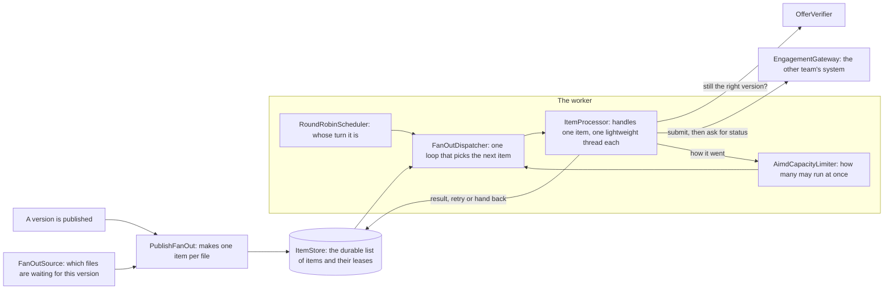
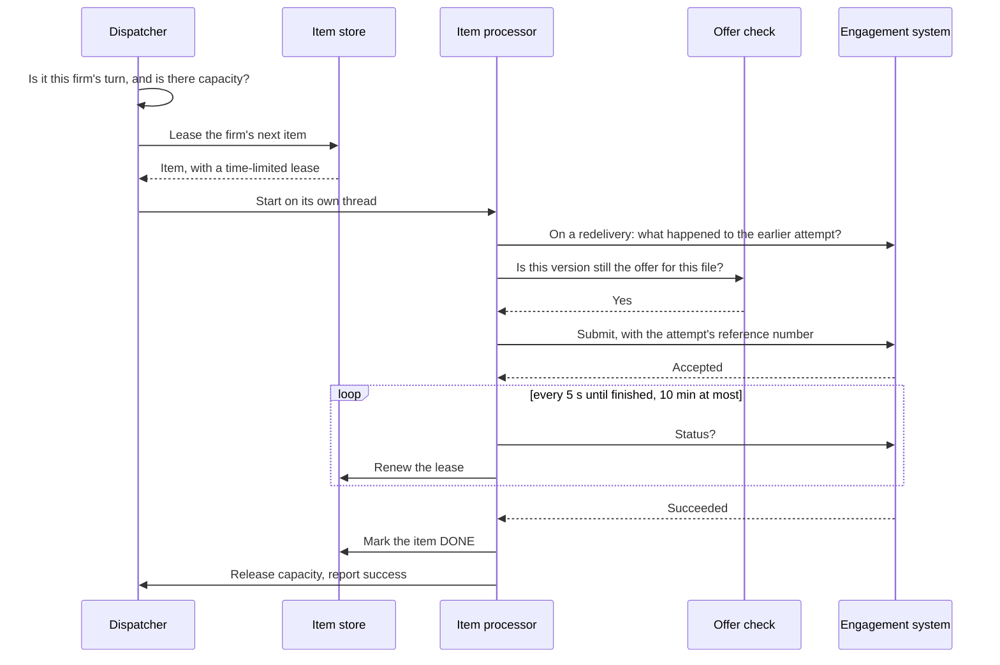
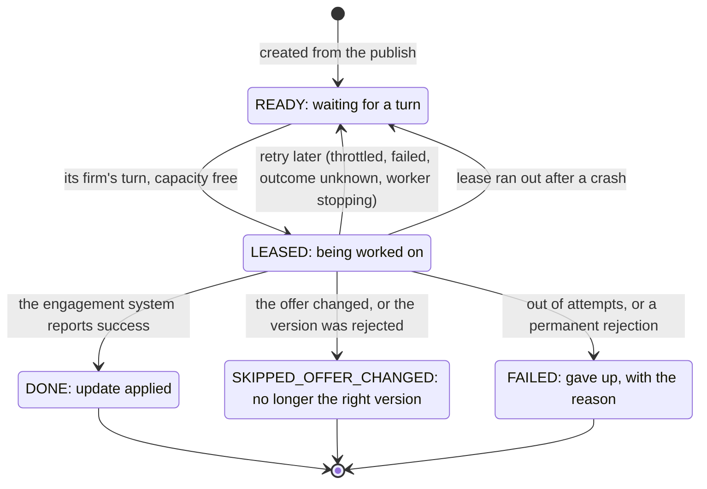

# Template-publish fan-out worker

The Java MVP from the [MVP brief](../docs/01-brief/mvp-brief.md), built as the core of the Load
Dispatcher described in the [architecture](../docs/03-architecture.md#11-load-dispatcher-bulk-decisions-and-the-mvp-worker), §11. It is a library, not an application: ports are
interfaces, and the store and downstream system are faked in tests.

```
mvn test        # Java 21+, Maven 3.9+
```

## In plain words

When a template version is published, a firm may want it applied to hundreds or thousands
of engagement files. Applying it to one file takes about a minute, and that minute is spent
in a system owned by another team, which can only handle so many at once.

This worker is the queue manager in between. It works like a ticket counter:

- **One ticket per file.** The publish is turned into a list of tickets, one per engagement
  file. Hearing about the same publish twice creates no extra tickets.
- **Firms take turns.** One ticket per firm per round, so a firm with 40,000 files cannot
  make a firm with 40 wait behind it.
- **It watches how busy the other system is.** It starts carefully, speeds up slowly while
  things go well, and halves its pace the moment the other system says "too many requests".
  If one firm's files keep causing trouble, only that firm is slowed down.
- **It checks before acting.** Just before a file's turn it asks whether this version is
  still the right one for that file. If the version was withdrawn or replaced, the file is
  skipped.
- **Nothing is done twice or lost.** Each attempt carries a reference number. After a crash
  or a timeout the worker first asks "what happened to this reference?" and carries on from
  the answer; it does not start again blindly.
- **It gives up in a defined way.** A file that keeps failing is tried a limited number of
  times, with longer waits in between, then marked as failed with the reason.

## Architecture at a glance

### The parts



The boxes outside the worker are interfaces ("ports"). The tests plug in fakes; production
plugs in a database, the engagement system and the offer lookup (see *Ports to implement
for production*).

### The life of one item



A **lease** is a time-limited claim on an item (5 minutes by default, renewed while work
continues). If the worker dies, the lease runs out and the item becomes available again. A
worker whose lease ran out can no longer write to that item, so two workers never record
conflicting results.

### Where an item can end up



### How the pace is set

| Signal from the engagement system | What the worker does |
|---|---|
| Everything is fine | Raises the overall limit a little at a time (by default +5 every 5 minutes, from 10 up to 100) |
| "Too many requests" (HTTP 429) | Halves the overall limit and stops starting new items for as long as asked, 15 minutes at most |
| Timeouts or errors for one firm's files | Halves that firm's own limit (50 by default); it recovers with time |
| Trouble from several firms at once | Lowers the overall limit too |

### Defaults

| Setting | Default |
|---|---|
| Items running at once, overall | Starts at 10, between 10 and 100 |
| Items running at once, per firm | 50 |
| Lease | 5 minutes |
| Status check | Every 5 seconds |
| Wait for one attempt | 10 minutes |
| Attempts per item | 3, with a wait of 30 seconds to 10 minutes between them |

The rest of this page is the technical reference.

## How one publish is processed

1. `PublishFanOut` turns the publish into durable items, one per engagement. The item id is
   derived from `(firm, product, version, engagement)` as `firm/product@seq/engagement`, so a redelivered publish event adds nothing.
2. `FanOutDispatcher` (one thread) starts an item only when three things hold: the firm is
   next in round-robin order, the `CapacityLimiter` grants a permit, and the `ItemStore`
   grants a lease.
3. `ItemProcessor` (one virtual thread per item) re-checks that the version is still the
   engagement's offer, submits to the downstream system with an idempotency key, then polls
   for the outcome while renewing the lease.
4. A redelivered item (after a crash, a restart or a timeout) first asks the downstream
   system what became of the earlier attempt, and adopts that answer before doing anything
   else.

## Where each concern lives

| Concern | Mechanism | Code |
|---|---|---|
| Concurrency | Virtual thread per in-flight item; exclusive, time-bounded leases with a fencing token | `FanOutDispatcher`, `ItemStore`, `Lease` |
| Downstream capacity | Global limit adapted by AIMD (halve on a 429, grow slowly while healthy), a per-firm cap, and a full admission pause for as long as a 429 asks, never longer than 15 minutes. Timeouts, unreadable statuses and submit transport errors are firm-scoped: they halve that firm's own cap (minimum 1), which climbs back by time alone, one step per increase interval, so an idle firm recovers too; only trouble from two or more firms in one cooldown window also lowers the global limit. `AimdConfig.fixed` switches adaptation off, firm caps included (a 429 still pauses). The limiter is in memory: see *Capacity bounds* below | `AimdCapacityLimiter`, `CapacityFeedback` |
| Fairness | Round robin across firms, one item per turn; a firm whose lease call fails is skipped for a doubling cool-off (cap 1 minute) so it cannot stall the others; a pass that itself keeps failing backs off with a doubling delay (cap 1 minute) and logs its stack trace only for the first failure of a run; an `Error` ends the loop with an ERROR log and `isRunning()` turns false | `RoundRobinScheduler`, `FanOutDispatcher` |
| Idempotency | Deterministic item ids; ids restricted to `[A-Za-z0-9._-]{1,128}` so the joined form is unambiguous and safe to log; attempt id reused while the outcome is unknown, rotated only after a definite failure | `WorkItem`, `ItemId`, `RequeueReason` |
| Failure | Bounded deliveries, jittered exponential backoff, terminal `FAILED`; a stopping worker hands its items back at once with the delivery refunded (never below 1, so the next delivery still polls), and `close()` waits up to 10 s after interrupting for those hand-backs; a killed worker's items return when their lease expires; a delivery that never reached the downstream system (throttled, offer check or store down, status unreadable on a redelivery) is refunded, not spent, but only 20 times in a row (`maxDeferrals`), with a backoff that grows per deferral and is capped at the retry maximum, after which a throttled item or one whose offer check or lease renewal failed is `FAILED` and says why; an item whose status is unreadable on a redelivery is never failed this way, since an earlier delivery may have submitted it: it keeps being requeued with a warning; a status that cannot be read three times in a row releases the item and never fails it; a submit that fails because of a shutdown interrupt is handed back, not counted as a transport error; a downstream success that cannot be recorded, or that the capacity feedback chokes on, never fails the item, it is left to lease expiry and the next delivery finishes it; a rejection because the version no longer applies ends as `SKIPPED_OFFER_CHANGED`, any other as `FAILED`; a store write that reports a lost lease is logged and its follow-ups skipped (a success is not reported to the limiter); the detail stored with a terminal status is one line of at most 500 characters | `ItemProcessor`, `RetryPolicy`, `SubmitResult` |
| Correctness | Offer pin re-checked at dispatch time; stale leases cannot write | `OfferVerifier`, `ItemStore` |

## Ports to implement for production

| Port | Production adapter |
|---|---|
| `ItemStore` (= `ItemIntake` + `ItemLeasing` + `LeaseWriter`) | Regional Aurora table; lease with `FOR UPDATE SKIP LOCKED`, fenced writes with `WHERE lease_token = ?` |
| `EngagementGateway` | Engagement system bulk lane; must deduplicate on the attempt id, enforce the version pin, and time out its calls |
| `OfferVerifier` | Lookup against the per-branch offer map |
| `FanOutSource` | Query of pending engagements for the published version |

`InMemoryItemStore` (test sources) is the reference for the `ItemStore` contract.
`ItemStoreContractTest` states that contract as tests; a real store passes it by extending
the class and supplying a fresh store (`InMemoryItemStoreTest` does so for the fake).

## Capacity bounds

The limiter keeps its state in memory, so the global limit and the per-firm caps hold per
process. They bound the load on the downstream system only while a single dispatcher is
active; the architecture runs it behind leader election. Several workers on one store are
safe for exactly-once processing, because leases live in the store, but each has its own
limiter, so the limits multiply by the number of workers.

## Known limits

- An item whose attempts all time out ends as `FAILED` with detail "outcome unknown" (the wait is measured in elapsed time, so a wall-clock step does not cut it short). The
  attempt may still finish downstream later; the architecture's reconciliation (§10) is what
  corrects the record in that case.
- The offer check and the submit are not atomic, so the downstream system must reject a
  command for a version that no longer applies.

## The `NOT_FOUND` contract

The worker relies on `NOT_FOUND` from `EngagementGateway.status` meaning that the key was
never accepted. A downstream system that can report `NOT_FOUND` for an accepted key beyond
the short grace (the first three reads in a row after this delivery's own accepted submit,
which tolerates a status endpoint that lags the submit) can cause a resubmit under the same
key (safe, since submit is idempotent on the key) or, if the offer changed meanwhile, a
`SKIPPED_OFFER_CHANGED` for an engagement that was in fact updated.

## Decisions that differ from the architecture

- **The idempotency key is rotated after a definite retryable downstream failure.** The
  architecture says the attempt id is reused on retry. Here a retry after `FAILED_RETRYABLE`
  uses a new key, because reusing it would make the downstream system replay the recorded
  failure. The key is still reused whenever the outcome is unknown.
- **The lease is renewed on every status poll while the attempt is not final**, not only
  while the downstream system reports progress. It is bounded by the attempt timeout, after
  which the delivery gives up and the lease is no longer extended.
- **Firm-scoped trouble signals sit alongside the global AIMD limit.** A 429 halves the
  global limit; timeouts, unreadable statuses and submit transport errors halve only that
  firm's cap, and the global limit drops as well only when several firms report trouble close together.

## Left out on purpose

Job cancellation, the monthly load-minute ceiling, completion events (the worker polls),
lane weights, metrics, and any framework wiring. Also not here, though the architecture's
dispatcher has them:

- The `SKIPPED_NOT_PERMITTED` and `CANCELLED` item states.
- A per-firm cap that is configurable per firm; every firm gets the same cap.
- AIMD triggers other than a 429 and firm trouble: the Elasticsearch interactive p95 and
  pool saturation do not move the limit.
- Re-driving `FAILED` items; a failed item stays failed until something outside the worker acts on it.
- Leader election; run one dispatcher per store, or accept that the capacity limits multiply
  (see *Capacity bounds*).
